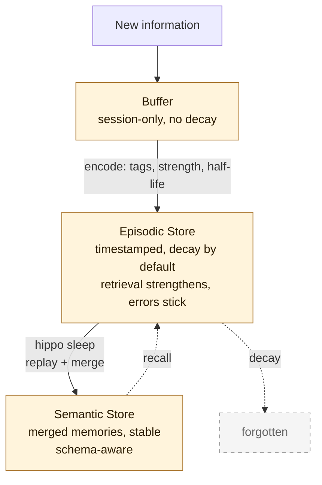
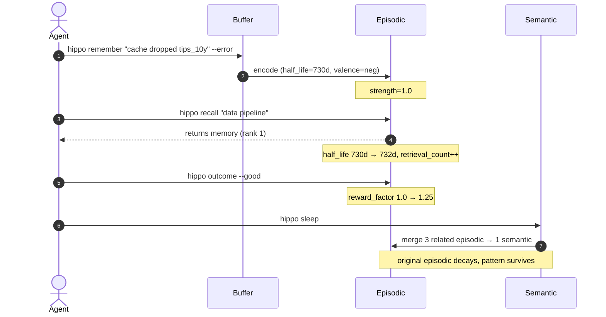

#  Hippo

**One memory for every agent you'll ever use.**

Inspired by the human hippocampus, hippo saves what you teach one coding agent in your repo, and your other agents read it, so switching agents stops meaning starting over.

[](https://npmjs.com/package/hippo-memory)
[](https://npmjs.com/package/hippo-memory)
[](https://github.com/kitfunso/hippo-memory/actions/workflows/ci.yml)
[](https://github.com/kitfunso/hippo-memory/blob/master/LICENSE)
[](https://hippo-memory.com)

<p align="center">
  
</p>

```
Works with:    Claude Code, Codex, Cursor, Pi, OpenClaw, OpenCode, any MCP client
Imports from:  ChatGPT, Claude (CLAUDE.md), Cursor (.cursorrules), Slack, markdown
Storage:       SQLite with markdown mirrors you can read and commit
Dependencies:  Zero runtime deps. Node.js 22.16+. Embeddings: `hippo init` installs the local Transformers.js embedder (`@huggingface/transformers@4.3.2`, about 480 MB) into a global npm install, and `--no-embeddings` skips it. An API embedder (OpenAI/Voyage/Cohere) is opt-in.
```

**Contents:** [Install](#install) · [Follow one memory](#follow-one-memory) · [What hippo does](#what-hippo-does) · [Results](#repeat-mistakes-per-100-chances) · [Setup in detail](#setup-in-detail) · [Agent setup](#framework-integrations) · [MCP server](#mcp-server) · [How it works](#how-it-works) · [CLI](#cli-reference) · [Comparison](#comparison) · [Benchmarks](#benchmarks) · [FAQ](#faq) · [Contributing](#contributing)

---

## Install

Paste one prompt into your agent:

```text
Install hippo-memory for me by following https://github.com/kitfunso/hippo-memory/blob/master/llms-install.md step by step. Run every command yourself and finish with hippo doctor.
```

Or by hand:

```bash
npm install -g hippo-memory

# then, in your project
hippo init
```

Installing the package alone captures nothing, and what runs after init depends on the agent.

`hippo init` creates a `.hippo/` store in the project, adds a short block to an existing `CLAUDE.md` or `AGENTS.md`, installs Claude Code's hooks, schedules a daily run at 6:15am that stores lessons from the day's commits and installs the local embedder for recall by meaning. `--no-hooks`, `--no-schedule` and `--no-embeddings` skip those parts. Codex runs hippo's hooks only once you trust them in `/hooks`. `hippo doctor` checks the install. [What hippo init changes](#what-hippo-init-changes) lists every file it writes, and [llms-install.md](llms-install.md) is the guide the prompt above follows.

---

## Follow one memory

1. **You correct your agent once.** Say always, never or must, and hippo's session-end hook pins it.
2. **Next session, it's already there.** Your rules load before your first prompt.
3. **Every agent reads it.** All your agents read one store, so switching loses nothing.
4. **Each prompt gets what's relevant.** Your pinned rules, plus up to 5 memories that share its words.
5. **A wrong memory gets weaker.** After a bad answer, `hippo outcome --bad` weakens the memories behind it.
6. **A new fact replaces the old.** With `hippo supersede`, the old one leaves recall but stays on record.
7. **Unused fades, pinned stays.** Unused memories weaken over a year or two, and pinned ones never fade.

---

## What hippo does

| | What it does | Where |
|---|---|---|
| **Capture** | Rules and errors from each session, found by word patterns. | `SessionEnd` hook |
| **Recall** | Keyword search with no model or network call, and `--why` shows the match. | `hippo recall "why did the deploy break" --why` |
| **Outcomes** | A bad mark weakens a memory, and each recall keeps it longer. | `hippo outcome --bad` |
| **Mirror** | A markdown copy of every memory to grep, commit and review. | `.hippo/` |
| **Dashboard** | Memory health by project, on localhost. | `hippo dashboard` |
| **Git history** | Learns from the last 30 days of commits, then each day's. | `hippo learn --git` |
| **Sleep** | Merges related memories and stores faded ones, ready to restore. | `hippo sleep` |
| **Import** | Brings in the notes your agents already keep, unchanged. | `hippo import --agents` |

---

## Repeat mistakes per 100 chances

Real sessions on 29 repositories, with the plan registered before the run.

| Claude Code with | Repeats per 100 chances |
|---|--:|
| No memory | 83 |
| Built-in memory | 21 |
| Built-in plus hippo | **11** |

Cost with hippo: 1.006 times, the same.

The gain was the same with lesson capture switched off, so this run cannot say hippo's stored lessons caused it. The test agent was Claude Code only, so there's no measured result for Codex or Cursor. The [result](docs/evals/2026-11-08-z0-round3-result.md) has every figure, and [Benchmarks](#benchmarks) has the rest of the test.

### Public memory tests

One answer model and scorer for every system we ran in a test.

| Test | Questions | hippo | Other system |
|---|--:|--:|---|
| DMR | 495 | 77.6 | full chat 83.6 |
| PersonaMem v1 | 584 | 72.4 | MemOS 61.2, published |
| LongMemEval-S | 495 | 88.5 | |
| LoCoMo | 395 | 89.4 | Mem0 94.9 |

hippo used its local embedder, plus its local reranker on DMR. MemOS's score is from its own setup. [How we test](#benchmarks).

---

## Zero model calls to store a memory

Other memory tools run what you save through a language model, an LLM on top of your LLM.

| Tool | LLM calls per memory | Unit |
|---|--:|---|
| hippo | 0 | per memory, default path |
| Mem0 | 1 | per add |
| Zep (Graphiti) | 2+ | per episode, more for duplicates and dates |
| Letta | 2+ | per turn that writes memory, V1 server |
| Supermemory | count not public | uses a model, per its docs (low confidence) |
| Cognee | 1 | per text chunk, with a key |
| LangMem | 1+ | per run |
| MemOS | 1 | per message window |

Storing the LoCoMo test chats took Mem0 5,882 language-model calls, one per turn, and hippo none ([the count](benchmarks/public/results/2026-11-12-answer-accuracy/mem0-locomo-ingest-gate.json)). Counts come from each product's public code and docs, 13 Nov 2026.

The exception is `hippo sleep`, which sends text to Anthropic when `ANTHROPIC_API_KEY` is set, and `{"extraction":{"enabled":false}}` turns it off. With `HIPPO_LLM_BASE_URL` and `HIPPO_LLM_MODEL` set, the text goes to that OpenAI-compatible endpoint instead, and never to Anthropic.

Your own model needs two variables, and two more are optional. `HIPPO_LLM_BASE_URL` is the endpoint, such as `https://llm.internal/v1`. Hippo posts to `<base>/chat/completions`. `HIPPO_LLM_MODEL` is the model name it sends on every call. `HIPPO_LLM_API_KEY` is optional and goes out as a Bearer token; it holds visible ASCII only, with no space or newline. The URL must use https unless it is on this machine. Set `HIPPO_LLM_ALLOW_HTTP=1` to allow plain http to another host, and set `NODE_EXTRA_CA_CERTS` to trust a private certificate authority. Hippo refuses to call a model, and says why, when the base URL has no model, when a model or key is set without a base URL, when the URL carries a query or a fragment, when plain http lacks the opt-in, or when a key cannot be a header. A refusal never falls back to Anthropic.

---

## One memory, three readers

You, your team and your platform lead read the same store.

- **The developer.** Say a rule with never, always or must, and every session starts with it.
- **The team.** Commit the markdown copy and review a rule in a pull request.
- **The platform lead.** One team server gives everyone the same store and their own key.

| Agent | What hippo adds |
|---|---|
| Claude Code | `CLAUDE.md` + 9 hooks |
| Codex | `AGENTS.md` + 2 hooks |
| Cursor | plugin: rule + MCP (`extensions/cursor-plugin`), or reads `AGENTS.md` |
| Pi | reads `AGENTS.md` |
| OpenClaw | plugin |
| OpenCode | plugin |
| Gemini CLI | extension: `gemini extensions install https://github.com/kitfunso/hippo-memory` |
| Kiro | power: import `https://github.com/kitfunso/hippo-memory/tree/master/extensions/kiro-power` |
| Any MCP client | `hippo mcp`, 13 tools |

`hippo dashboard` opens a local page with each project's memory health.

---

## Memory is infrastructure you own

Your agents' memory belongs in a file you can read, diff and delete, whichever agent you use next year.

- **Today:** a team server that shares one store over MCP, with API keys, roles, an audit log, and Slack and GitHub connectors.
- **Planned:** a commercial edition with SSO, SCIM, SIEM export, hosting and an SLA.

There's no team result yet, so [open an issue](https://github.com/kitfunso/hippo-memory/issues/new?title=Pilot%20request&body=Company%2C%20team%20size%2C%20agents%20in%20use%3A) for a holdout pilot. [Open source and commercial](#open-source-and-commercial) says what each edition holds.

---

## Setup in detail

**Many repos at once.** Read what it changes first. `hippo init --scan <folder>` looks for git repos in the folder and up to three levels below it, skipping dot-folders and `node_modules`. Each repo gets a `.hippo/` store, seeded with lessons from the last 365 days of its commits and with its [agent memories](#agent-memories), and is added to the daily run's list. For the agents it finds, it installs the same user-level hooks as `hippo init`: 9 Claude Code hook entries in `~/.claude/settings.json`, the OpenCode plugin, and the Copilot files when the Copilot CLI is installed. It also sets up the daily 6:15am run, a crontab line on Linux and macOS or a scheduled task on Windows. It adds no block to any repo's `CLAUDE.md` or `AGENTS.md`. `--no-hooks`, `--no-schedule` and `--no-learn` leave out the hooks, the daily run and the history import.

```bash
hippo init --scan ~
```

After setup, `hippo sleep` runs when a Claude Code or OpenCode session ends, and in the daily 6:15am job for every project. Codex runs it at session end only if you installed its wrapper. It does five things:

1. **Learns** from today's git commits
2. **Imports** what your coding agents remember, about this project and about you ([Agent memories](#agent-memories))
3. **Consolidates** memories (decay, merge, prune)
4. **Deduplicates** identical memories, keeping the stronger copy
5. **Shares** high-value lessons to a global store so they surface in every project

```bash
# Manual usage
hippo remember "FRED cache silently dropped the tips_10y series" --tag error
hippo recall "data pipeline issues" --budget 2000
```

---

Full release history: **[CHANGELOG.md](./CHANGELOG.md)** · [GitHub Releases](https://github.com/kitfunso/hippo-memory/releases)


### What hippo init changes

Run `hippo init` inside one project. This is everything it writes, in the project and on your machine:

- **The project's store.** A `.hippo/` folder: SQLite plus markdown mirrors. On the first run in a git repo it learns lessons from the last 30 days of commits.
- **Instruction files.** A block between `<!-- hippo:start -->` and `<!-- hippo:end -->` in the project's `CLAUDE.md` or `AGENTS.md`, only if that file already exists. Codex, Cursor, OpenClaw, OpenCode and Pi read `AGENTS.md`.
- **Claude Code,** when the project has `CLAUDE.md` or `.claude/settings.json`: 9 hook entries in `~/.claude/settings.json`, one each on SessionEnd, UserPromptSubmit, PreCompact, PostCompact, PostToolUseFailure and PostToolUse and three on SessionStart. [Framework Integrations](#framework-integrations) says what each one runs.
- **OpenCode,** when the project has `.opencode/` or `opencode.json`: a plugin at `~/.config/opencode/plugins/hippo.ts`.
- **Codex,** when the project has `AGENTS.md` or `.codex` and Codex is installed (`$CODEX_HOME`, else `~/.codex`, exists): 2 hook entries in Codex's `hooks.json`, one on UserPromptSubmit that sends your pinned memories plus up to 5 that match the prompt with every prompt and one on SessionStart after a compaction. **Codex runs them only after you trust them once in `/hooks`.** Init also prints `hippo hook install codex`, the opt-in that wraps the Codex launcher to capture sessions; `hippo hook uninstall codex` removes hippo's hooks and the wrapper.
- **GitHub Copilot,** when the Copilot CLI is installed, whatever the project holds. Init takes `$COPILOT_HOME` (else `~/.copilot`) holding more than a `hooks` folder as the sign. It writes the same files as `hippo hook install copilot`: hippo's `hooks/hippo.json`, a `hippo` server in `mcp-config.json` and a block in `copilot-instructions.md`. When VS Code has a User folder, it also adds the server to that folder's `mcp.json` and writes `prompts/hippo.instructions.md`. With VS Code alone, run `hippo setup`. [integrations/copilot.md](integrations/copilot.md) lists each file and how to remove them.
- **A daily run at 6:15am,** one per machine: a crontab line on Linux and macOS, a scheduled task named `hippo-daily-runner` on Windows. It runs `hippo learn --git --days 1` and then `hippo sleep` in every project listed in `~/.hippo/workspaces.json`, and init adds this project to that list.
- **The local embedder,** when hippo is a global npm install and no embedder is installed yet: `@huggingface/transformers@4.3.2` in the same global folder, about 480 MB. It goes in before anything else, can take a few minutes, and runs with `--ignore-scripts`, so no install script in that package tree runs. Its model (`Xenova/all-MiniLM-L6-v2`, 87 MB) downloads from Hugging Face the first time hippo embeds. Under npx, pnpm, yarn, bun or as a project dependency, init prints the command for that setup instead. `npm uninstall -g hippo-memory` leaves the embedder in place; `npm uninstall -g @huggingface/transformers` removes it.
- **Agent memories.** On every run, the notes your coding agents keep about this project go into its store, and the ones about you go into the global store. [Agent memories](#agent-memories) lists what is read.

```bash
cd my-project
hippo init

# Initialized Hippo at /my-project/.hippo
#    Directories: buffer/ episodic/ semantic/ conflicts/
#    Files: hippo.db stats.json
#    Auto-installed claude-code hook in CLAUDE.md
#    Auto-installed hippo session-end SessionEnd hook in claude-code settings
#    (one line per hook entry)
#    Scheduled machine-level daily runner (6:15am) via crontab
```

To leave parts out: `--no-hooks` skips the instruction files and hooks, `--no-schedule` the daily run, `--no-embeddings` the embedder install, and `--no-learn` the git history and agent memory import. `HIPPO_SKIP_AUTO_INTEGRATIONS=1` skips the same files and hooks that `--no-hooks` does, `HIPPO_SKIP_SCHEDULE=1` skips the daily run as `--no-schedule` does, and `HIPPO_SKIP_EMBEDDER_INSTALL=1` skips the embedder as `--no-embeddings` does.

### Agent memories

Most coding agents now keep their own notes between sessions. Hippo reads them, whatever the tool, so what one agent learned reaches the others. It reads files only and never writes to another tool's folders.

When: `hippo init` (every run), `init --scan`, `init --global`, `hippo setup`, every `hippo sleep` and the daily run. At session end a folder with its own store gets it through sleep; a folder without one sends its project's notes to the global store, marked with the project's name. After a Claude Code compaction, the session's own notes folder is read as well.

What is read, per tool (each tool's own environment variables and settings decide where its home is):

- **Claude Code:** the project's auto memory notes under `~/.claude/projects/<project>/memory/` (front matter required, `MEMORY.md` skipped), and the `autoMemoryDirectory` folder from your user settings.
- **Codex:** the User Profile, preferences and tips in `~/.codex/memories/memory_summary.md`.
- **Gemini CLI:** the "Gemini Added Memories" section of `~/.gemini/GEMINI.md`, and the project's auto memory folder when that feature is on.
- **GitHub Copilot Chat in VS Code:** the memory tool's user memories and the repository memories of this project's workspace.
- **OpenClaw:** the workspace's `MEMORY.md`.
- **Qwen Code:** the project's auto memory folder and your user memories.

Each imported memory follows its note. It stays while the note exists, is replaced when the note changes, and is set aside as dormant when the note is deleted (`hippo dormant` lists it and can restore it). A note shorter than 10 characters, one that looks like it holds a secret (an API key, a password, an auth header or a token), and one whose text you rejected with `hippo reject` are skipped. Email addresses are stored masked, and notes are cut at 1,500 characters.

Not read: Windsurf (the file format is not documented, and Cascade reached end of life on 1 July 2026); Cursor, Copilot CLI and GitHub's Copilot Memory (the memories live on the vendor's servers); Kiro (the local store is not documented); Cline and Roo memory banks (files in the repository, which `hippo import --markdown` covers); Amp, Aider, Continue, OpenCode and pi (no memory feature found).

`hippo import --agents` runs the import by hand; in a folder without a store it does what session end does there. With `--dry-run` it shows each tool's home, the folders found and what would change, and writes nothing. To choose tools, set `"agentMemories": { "tools": ["claude-code", "codex"] }` in `.hippo/config.json` (`[]` turns the import off), or `HIPPO_AGENT_MEMORY_TOOLS=claude-code,codex` in the environment (`none` turns it off), which wins over config.

---

## Cross-Tool Import

Hippo imports the notes and rules you already keep in other tools. `hippo import --agents` reads what your coding agents remember ([Agent memories](#agent-memories)); these commands read files:

```bash
# ChatGPT memory export
hippo import --chatgpt memories.json

# Claude's CLAUDE.md (skips existing hippo hook blocks)
hippo import --claude CLAUDE.md

# Cursor rules
hippo import --cursor .cursorrules

# Any markdown file (headings become tags)
hippo import --markdown MEMORY.md

# Any text file
hippo import --file notes.txt
```

All import commands support `--dry-run` (preview without writing), `--global` (write to `~/.hippo/`), and `--tag` (add extra tags). Duplicates are detected and skipped automatically.

### Conversation Capture

Store memories from conversation text. Word patterns, not a model, find decisions, rules, errors and preferences.

```bash
# Pipe a conversation in
cat session.log | hippo capture --stdin

# Or point at a file
hippo capture --file conversation.md

# Preview first
hippo capture --file conversation.md --dry-run
```

#### Rules from follow-up turns (opt-in, uses a model)

Word patterns pin a later turn only when it holds a rule word (never, always, must, make sure) or a preference word that names code or limits a choice. Any other statement that names code or limits a choice, such as "Run the tests with `pnpm test:unit`, not the bare `pnpm test`", stays an unpinned note that only a matching prompt or `hippo recall` brings back. Patterns store nothing from "That file is generated, so changes belong in the template it comes from." With `{"capture": {"followUpRules": "model"}}` in `.hippo/config.json` and a model set (`ANTHROPIC_API_KEY`, or `HIPPO_LLM_BASE_URL` for your own endpoint), a session capture also asks a model which of your sentences state a lasting rule. Hippo stores those sentences, in your own words, as pinned rules.

- **What it sends:** your turns after the first one in the session, the last 20, each cut to 1,000 characters. Pasted blocks, fenced code and log lines are removed first, and secrets, email addresses and home paths are masked. The assistant's replies are never sent.
- **To whom:** your own endpoint when `HIPPO_LLM_BASE_URL` is set, else Anthropic with your `ANTHROPIC_API_KEY`, in one call per session capture. A failed call logs one line and capture keeps its pattern rules. A session with no project never makes the call.
- **On and off:** the default is `"off"`. Set `"model"` to turn it on; set `"off"` again, or unset `ANTHROPIC_API_KEY` and `HIPPO_LLM_BASE_URL`, to turn it off.

#### What you type

The session-end hook also saves each message you type of 3 or more words, as you typed it. A fact you tell the agent in chat, such as a name or a date, then comes back in a later session. Hippo never saves the agent's replies.

- **How it is stored:** one `kind='raw'` row per message, with the tag `user-message`, the owner `user:<you>` and a `session:<id>/<hash>` reference. Secrets and email addresses are masked first. A message over 2,000 characters keeps your own words without the pasted code, then is cut.
- **Where:** only the project's own store. The global store, `hippo capture --stdin` and `--file` never save messages.
- **When it comes back:** a prompt that shares words with it, or `hippo recall`. It never fills the prompt hook's recent list, has no markdown mirror, and is never shared to the global store or merged.
- **On and off:** the default is on. Set `{"capture": {"userMessages": false}}` in `.hippo/config.json` to turn it off. To remove one message, run `hippo forget <id> --archive --reason <why>`.
- A capture after each reply (`--turn`, as VS Code's agent mode runs) never calls the model, so those runtimes gain little.

### Slack ingestion (E1.3)

Hippo accepts Slack Events API webhooks at `POST /v1/connectors/slack/events`. Configure `SLACK_SIGNING_SECRET` (validated on every request) and point Slack at `https://<your-host>/v1/connectors/slack/events`. Messages land as `kind='raw'` memories with `slack://team/channel/ts` provenance and a `slack:public:Cxxx` or `slack:private:Cxxx` scope. Source deletions are honored (GDPR). To rotate the secret, put the new one in `SLACK_SIGNING_SECRET` and the old one in `SLACK_SIGNING_SECRET_PREVIOUS`, and set `SLACK_SIGNING_SECRET_PREVIOUS_UNTIL` to an ISO date (`2026-12-01` means 00:00 UTC that day) or timestamp. From then on requests signed with the old secret are refused, with one warning in the log. Left unset, the old secret works for as long as it stays in the environment.

Backfill an existing channel: `SLACK_BOT_TOKEN=xoxb-... hippo slack backfill --channel C0000`. Inspect malformed events: `hippo slack dlq list`.

Multi-workspace deployments populate `slack_workspaces (team_id, tenant_id)` to route events per tenant; single-workspace falls back to `HIPPO_TENANT`.

GitHub webhooks land the same way at `POST /v1/connectors/github/events`. Backfill a repository's issues and comments with `hippo github backfill --repo <owner/name>`. Every memory carries `kind`, `scope`, `owner` and `artifact_ref`, and one API call deletes a memory. For GitHub Enterprise Server, set `GITHUB_ENTERPRISE_URL=https://<host>`, using the host name the server is configured with. Backfill then calls `https://<host>/api/v3`, and refs, `repo:` tags, scopes and cursors carry the host, as in `github://<host>/<owner/name>/issue/<n>`; github.com refs do not change. GHES webhooks keep working unchanged while `GITHUB_ENTERPRISE_URL` is unset. Once you set it, new rows carry the host in their scope and `repo:` tag, and older rows keep the bare form. If the store took GHES webhooks before you set it and never took github.com ones, also set `GITHUB_ENTERPRISE_BARE_REFS_HOST` to the same host, so a deletion archives the older copy and a backfill skips items those webhooks stored; without it hippo never treats a row with no host as a GHES row. `hippo github dlq replay` checks the server the payload names for every row, whatever its bucket. Grant member keys the host form too, query both scopes, and set the variable before you replay any `host_mismatch` row. Once the variable is set, every github.com delivery parks as `host_mismatch`, so a store that takes both github.com and GHES hooks must keep the variable unset or split to two servers.

### Active task snapshots

Hippo can save the task in progress, so a later session can pick it up where this one stopped.

```bash
hippo snapshot save \
  --task "Ship SQLite backbone" \
  --summary "Tests/build/smoke are green, next slice is active-session recovery" \
  --next-step "Implement active snapshot retrieval in context output"

hippo snapshot show
hippo context --auto --budget 1500
hippo snapshot clear
```

`hippo context --auto` prints the active task snapshot before long-term memories when the calling session saved it, so agents get both the immediate thread and the deeper lessons. A snapshot from another session prints as one line that names the command that shows it.

### Session event trails

Hippo can store short session events and link them to the active snapshot, so context output shows the latest steps as well as the last summary. The trail prints for the calling session's own snapshot; for another session's, the command in the pointer line prints it.

```bash
hippo session log \
  --id sess_20260326 \
  --task "Ship continuity" \
  --type progress \
  --content "Schema migration is done, next step is CLI wiring"

hippo snapshot save \
  --task "Ship continuity" \
  --summary "Structured session events are flowing" \
  --next-step "Surface them in framework hooks" \
  --session sess_20260326

hippo session show --id sess_20260326
hippo context --auto --budget 1500
```

Hippo mirrors the latest trail to `.hippo/buffer/recent-session.md` so you can inspect the short-term thread without opening SQLite.

### Session handoffs

When you're done for the day (or switching to another agent), create a handoff so the next session knows exactly where to pick up:

```bash
hippo handoff create \
  --summary "Finished schema migration, tests green" \
  --next "Wire handoff injection into context output" \
  --session sess_20260403 \
  --artifact src/db/index.ts

hippo handoff latest              # show the most recent handoff
hippo handoff show 3              # show a specific handoff by ID
hippo session resume              # re-inject latest handoff as context
```

The per-prompt hook (Claude Code and Codex) prints only your own session's handoff. It no longer prints another session's handoff, not even as a pointer. To pick up another session's work, run `hippo context --auto`.

### Working memory

Working memory is a bounded scratchpad for current-state notes. It's separate from long-term memory. Entries stay until you run `hippo wm flush`.

```bash
hippo wm push --scope repo \
  --content "Investigating flaky test in store.test.ts, line 42" \
  --importance 0.9

hippo wm read --scope repo        # show current working notes
hippo wm clear --scope repo       # wipe the scratchpad
hippo wm flush --scope repo       # same as clear; nothing runs it at session end
```

The buffer holds a maximum of 20 entries per scope. When full, the lowest-importance entry is evicted.

### Explainable recall

`--why` shows, for each memory recall returns, the words of your query it matched, the embedding similarity when an embedder is on, and where the memory came from:

```bash
hippo recall "data pipeline" --why --limit 5
```

`hippo explain "<query>"` prints the full score breakdown for each result.

---

## How It Works

Every memory has a strength. It fades on a half-life, grows each time the memory is recalled, and drops when you mark it wrong. The hippocampus inspired the design, and we tested each part on its own. On synthetic tests, outcome marks and recall strengthening helped and decay made no measurable difference. Sleep lowered recall on one scorer, and the rest is unmeasured. The design notes are in [PLAN.md](PLAN.md#core-principles) and [RESEARCH.md](RESEARCH.md).

- **Buffer.** New information lands here for the session.
- **Episodic.** Timestamped memories that fade unless they are used.
- **Semantic.** Patterns merged from related episodes during sleep, by word overlap.

The store is SQLite (`.hippo/hippo.db`). The markdown files are mirrors written after each change. `index.json` is no longer refreshed by writes, deletes or recalls, so a copy an older version left on disk goes stale. Read the store through the CLI, the MCP server or the HTTP API.



---

## Key Features

A memory's life across a typical session, before walking each feature in turn:



### Decay by default

A memory's strength halves each time a half-life passes without use, and the default half-life is 365 days. The default used to be 7 days, which turned out to be a bug. On a [test we registered first](docs/evals/2026-09-24-decay-default-result.md), the current version of a fact was in the top five 29.2% of the time at 7 days and 74.7% at 365. We did not tune 365. It tied with 730 days and with decay switched off, so on that test decay made no measurable difference. `hippo sleep` moves memories still on the old 7-day base to the new one, once, and records each move in the audit log. Set `defaultHalfLifeDays` in `.hippo/config.json` to choose your own, or pin a memory so it never decays.

```bash
hippo remember "always check cache contents after refresh"
# stored with half_life: 365d, strength: 1.0

# two years later with no retrieval:
hippo inspect mem_a1b2c3
# strength: 0.25  (decayed by 2 half-lives)
```

---

### Recall makes a memory last longer

Each recall adds 2 days to a memory's half-life, so 365 days becomes 367 and then 369. Recall ranks memories by relevance, strength and recency, and the strongest matches fill the token budget first. In the first round of our audit this helped on the synthetic test, in its best case.

```bash
hippo recall "cache issues"
# finds mem_a1b2c3, retrieval_count: 1 -> 2
# half_life extended: 365d -> 367d
# strength recalculated from retrieval timestamp

hippo recall "cache issues"   # again next week
# retrieval_count: 2 -> 3
# half_life: 367d -> 369d
```

---

### Active invalidation

When you move from one tool to another, old memories about the replaced tool should stop showing up at once. Hippo detects migration and breaking-change commits during `hippo learn --git` and actively weakens matching memories.

```bash
hippo learn --git
# feat: migrate from webpack to vite
#    Invalidated 3 memories referencing "webpack"
#    Learned: migrate from webpack to vite
```

You can also invalidate manually:

```bash
hippo invalidate "REST API" --reason "migrated to GraphQL"
# Invalidated 5 memories referencing "REST API".
```

---

### Architectural decisions

One-off decisions don't repeat, so they can't earn their keep through retrieval alone. `hippo decide` stores them with verified confidence and the store's default half-life, the same as any other memory, and sleep never retires the memory behind a decision. On a store made before 1.52.7, decisions get 90 days until the store's first `hippo sleep` on 1.52.7 or later moves them to the default.

```bash
hippo decide "Use PostgreSQL for all new services" --context "JSONB support"
# Decision recorded: #1
#   memory: mem_a1b2c3

# Later, when the decision changes:
hippo decide "Use CockroachDB for global services" \
  --context "Need multi-region" \
  --supersedes mem_a1b2c3
# Decision recorded: #2
#   memory: mem_d4e5f6
#   supersedes memory: mem_a1b2c3 (decision #1 superseded)
```

---

### Errors last twice as long

A memory stored with `--error`, or captured from a failed tool call, gets a 730-day half-life against the usual 365. We haven't measured whether that helps.

```bash
hippo remember "deployment failed: forgot to run migrations" --error
# half_life: 730d instead of 365d
# emotional_valence: negative
# strength formula applies 2.0x multiplier (HIPPO_LOSS_AVERSION_RATIO=0.75 to keep v1.13.4 1.5x)
```

---

### Confidence tiers

Every memory carries a confidence level: `verified`, `observed`, `inferred`, or `stale`. This tells agents how much to trust what they're reading.

```bash
hippo remember "API rate limit is 100/min" --verified
hippo remember "deploy usually takes ~3 min" --observed
hippo remember "the flaky test might be a race condition" --inferred
```

When context is generated, confidence is shown inline:

```
[verified] API rate limit is 100/min per the docs
[observed] Deploy usually takes ~3 min
[inferred] The flaky test might be a race condition
```

A memory not recalled for 30 days is shown as aged when it is read, and recalling it clears that. Pinned and `verified` memories are exempt. Nothing in the store changes.

### Conflict tracking

When two memories overlap in content and contradict each other, hippo records a conflict that `hippo conflicts` lists. Shared tags alone do not count; the statements themselves need to overlap in content. `hippo supersede <id> "<new fact>"` stores the new version of a fact and links the old one to it, `hippo recall --as-of <date>` shows what was current on a given day, and `hippo reject <id> --reason "<why>"` stops a value coming back at all. None of this is measured yet.

```bash
hippo sleep       # refreshes open conflicts
hippo conflicts   # inspect them
```

Open conflicts are stored in SQLite, mirrored under `.hippo/conflicts/`, and linked back into each memory's `conflicts_with` field.

---

### Observation framing

Memories aren't presented as bare assertions. By default, Hippo frames them as observations with dates, so agents treat them as context rather than commands.

```bash
hippo context --framing observe   # default
# Output: "Previously observed (2026-03-10): deploy takes ~3 min"

hippo context --framing suggest
# Output: "Consider: deploy takes ~3 min"

hippo context --framing assert
# Output: "Deploy takes ~3 min"
```

Three modes: `observe` (default), `suggest`, `assert`. Choose based on how directive you want the memory to be.

---

### Sleep consolidation

Run `hippo sleep` and related episodes merge into one memory.

```bash
hippo sleep

# Running consolidation...
#
# Results:
#    Active memories:    23
#    Removed (decayed):   4
#    Merged episodic:     6
#    New semantic:        2
```

Sleep merges two or more related episodes into one pattern, and the originals fade. It keeps the store tidy. It has not been shown to improve recall, and on one scorer a slept store scored 3.6 points lower than the same store never slept ([mechanism audit, round 2](https://github.com/kitfunso/hippo-memory/pull/232)).

**Experimental: learned memory-value rescue (opt-in, default off).** With
`{"memoryValue":{"enabled":true}}` in `.hippo/config.json`, sleep consults a learned
linear memory-value scorer before deleting a decayed memory: a memory that scores in the
top 30% of its tenant by learned value is kept ("rescued") even though its strength fell
below the decay threshold. The scorer can only rescue, never delete: with the flag on,
sleep deletes a strict subset of what it would delete with the flag off. Every rescue is
recorded in the audit log (`hippo audit list --op mv_rescue`). The weights were learned
on a LongMemEval retention test with simulated usage, so they do not measure real usage
value: treat the flag as an experiment.
Tenants with fewer than 10 non-pinned memories never rescue (rank statistics are noise at
tiny scale).

**Faded memories go dormant, not gone (on by default).** Sleep moves a memory that faded
below the decay threshold into a dormant store instead of deleting it. A dormant memory
leaves recall and context exactly like a deleted one and sits out every later sleep, so
your agent's context stays as lean as before, but nothing is lost:

```bash
hippo dormant                     # list, newest first (--json, --limit <n>)
hippo dormant "staging hostname"  # search: every term must match
hippo dormant restore mem_a1b2c3  # back to active memory, as if just recalled
hippo dormant forget mem_a1b2c3   # delete for good
```

A restored memory comes back with a fresh recall clock, so it gets a full half-life before
it can fade again, and every restore is logged (`hippo audit list --op dormant_restore`) as
a "forgot it, then needed it" signal. Two guardrails: a faded memory that the secret
detector flags is deleted, never kept dormant, and a dormant memory nobody restores within
`dormant.retentionDays` (default 180, `0` keeps them forever) is deleted for good. Rejecting
a value (`hippo reject`) removes its dormant copies too. To delete faded memories straight
away as before, set `{"dormant":{"enabled":false}}` in `.hippo/config.json`. Sleep never
removes pinned memories, raw receipts (Slack, GitHub, vault imports) or the memories a
Claude Code compaction saved either way, and duplicate removal and junk cleanup still
delete other memories. `hippo forget` still deletes a compaction memory.

**Clean up project names left by older versions.** Older versions tagged memories saved in
a git worktree with the worktree's folder name, and older sleep saved merged memories as
user-global, so every project could see them. Upgrading stops new damage; these commands
repair old rows. Each is a dry run until you add `--apply`. With `--apply`, it backs up the
database to `.hippo/backups/` first and logs every id it touched in the audit log:

```bash
hippo projects --global                        # names, counts, live worktrees of this repo
hippo projects merge hippo-wt-fix hippo --global   # fold an old worktree name into its repo
hippo projects repair --global                 # set aside note copies, fold old worktree names, re-tag merges
```

A project's name is the `id` in a committed `.hippo-project.json`, else its `origin` remote
(`github.com/acme/api`), else its folder name. So two repos both called `api` no longer share
memories in the global store. Rows saved under the old folder name stay visible to the
project, and `hippo projects repair` folds that name into the id unless two projects claim it.
`hippo sleep` runs that repair once per store after an upgrade, with a backup; in the global store
it leaves the name folds to you, since only `hippo projects repair --global` lists them for review.
Set `{"projectIdentity":{"remote":false}}` in the global `config.json` to keep folder names.
A long-running MCP or HTTP server reads a new project file or remote after a restart.

**See what memory costs in tokens.** Every block of memory text hippo hands an agent (the
per-prompt hook, the block `hippo compact-resume` restores after compaction, `hippo context`,
`hippo recall`, the MCP tools, the HTTP API) is recorded in a token ledger: counts, surface
and session, never the text. A block stays in the conversation, so each later model call
reads it again until the host compacts. When a Claude Code session ends, hippo counts those
calls in the session's transcript and records the re-read tokens for the per-prompt hook's
blocks and the compact-resume block, dated by the day of the calls. The other surfaces show sent tokens only: their rows
cannot tell a sub-agent's call from its parent's. `hippo tokens` shows sent and re-read
totals for the last 30 days (`--days`, `--json`). A session that is still open, or that
crashed, shows what was sent only. Re-reads usually bill at the provider's cached-input rate,
a fraction of the full input price. Counts are estimates (characters / 4), the same estimate
every budget uses. Rows older than 90 days are pruned.

**See why a memory did or did not reach the agent.** Turn on the delivery ledger with
`{"deliveryLedger":{"enabled":true}}` in `.hippo/config.json` (off by default). The flag is
read from the store the token ledger writes to: the project's local store when it has one,
else the global store. Each per-prompt hook call then records one event (session, turn
number, whether the block was sent, reused, empty or disabled, counts and token totals) and
one row per candidate memory: emitted, reused or rejected, with the stage and the
reason it was dropped. Each accepted `hippo pre-compact` and `hippo compact-resume` call
records one event too, with no candidate rows. With prompt recall on, recent memories dropped by the quality filter
are not recorded yet. It holds ids, hashes, counts and reasons only, never prompt or memory
text; the prompt hash is unsalted, so a very short prompt can be guessed. A ledger failure prints one stderr line and never changes what the hook prints. Rows
older than 90 days are pruned; at a heavy 300 prompts a day that is about 190 MB per store.

**Run a pilot with a holdout group.** Set `{"pilot":{"holdoutRateBp":2000}}` in `.hippo/config.json`
to hold back memories from about 20% of sessions. The rate is in basis points, 0 to 10000, and 0
is off (the default). The setting is read from the store the token ledger writes to. A session
lands in its arm by a hash of its id, and the first hook call writes one row to the token ledger.
A holdout session gets no memories from the per-prompt hook, the SessionStart hook or compact-resume.
The agent's own `hippo context` pull is gated in Claude Code only, so a Codex holdout session still
gets memories from it. Capture still runs. `hippo recall`, the HTTP API and the MCP tools are not gated
and write no arm row. Agents are told to call the MCP context tool at session start, and those calls
are not recorded. Set the rate to 0 only after the pilot window closes, because 0 ends every holdout at once.
`hippo doctor` shows the pilot when it is on.

---

### Outcome feedback

`hippo outcome --good` or `--bad` marks the memories from the last recall.

```bash
hippo recall "why is the gold model broken"
# ... you read the memories and fix the bug ...

hippo outcome --good
# Applied positive outcome to 3 memories
# reward factor increases, decay slows

hippo outcome --bad
# Applied negative outcome to 3 memories
# reward factor decreases, decay accelerates
```

Outcomes are cumulative. A memory with 5 positive outcomes and 0 negative has a reward factor of ~1.42, making its effective half-life 42% longer. A memory with 0 positive and 3 negative has a factor of 0.625, so it decays 1.6 times as fast; each bad mark past the good ones also halves its strength, up to three times, and recall stops strengthening it. Mixed outcomes converge toward neutral (1.0).

On a synthetic test where every mark was correct, a bad mark cut how often a wrong memory stayed in the top five from 71.9% to 0.0% ([mechanism audit, round 2](https://github.com/kitfunso/hippo-memory/pull/232)). Real marks are noisier, because `--bad` marks the whole recall batch.

---

### Token budgets

Recall prints only what fits the token budget.

```bash
# a small block for task context
hippo recall "deployment checklist" --budget 2000

# need more for a big task
hippo recall "full project history" --budget 8000

# machine-readable for programmatic use
hippo recall "api errors" --budget 1000 --json
```

Results are ranked by `relevance * strength * recency`. The highest-signal memories fill the budget first.

The budget counts the whole block as printed: the heading, each memory's label, date and tags,
and any snapshot or hint lines, so the token figure in the heading is the size of what the
model reads. Recall always keeps its first `--min-results` memories (default 1), even one
larger than the budget; `hippo context` skips a memory that does not fit and keeps filling.
`--json` returns the memories the text form would print.

---

### Auto-learn from git

Hippo can scan your commit history and extract lessons from fix/revert/bug commits automatically.

```bash
# Learn from the last 7 days of commits
hippo learn --git

# Learn from the last 30 days
hippo learn --git --days 30

# Scan multiple repos in one pass
hippo learn --git --repos "~/project-a,~/project-b,~/project-c"
```

The `--repos` flag accepts comma-separated paths. Hippo scans each repo's git log, extracts fix/revert/bug lessons, deduplicates against existing memories, and stores new ones. Pair with `hippo sleep` afterwards to consolidate.

Ideal for a weekly cron:

```bash
hippo learn --git --repos "~/repo1,~/repo2" --days 7
hippo sleep
```

---

### Watch mode

Wrap any command with `hippo watch` to auto-learn from failures:

```bash
hippo watch -- npm run build
# if it fails, Hippo captures the error automatically
# next time an agent asks about build issues, the memory is there
```

The command runs with no shell, so each argument reaches the program as written. To run a shell line with pipes or `&&`, name the shell: `hippo watch -- sh -c "npm test && npm run build"`.

---

## CLI Reference

| Command | What it does |
|---------|-------------|
| `hippo init` | Create `.hippo/`, install agent hooks and the daily run ([what it changes](#what-hippo-init-changes)) |
| `hippo init --global` | Create global store at `~/.hippo/` |
| `hippo init --no-hooks` | Create `.hippo/` without auto-installing hooks |
| `hippo setup` | Detect installed AI tools, install their hooks and import each agent's user-level memories |
| `hippo remember "<text>"` | Store a memory |
| `hippo remember "<text>" --tag <t>` | Store with tag (repeatable) |
| `hippo remember "<text>" --error` | Store as error (2x half-life) |
| `hippo remember "<text>" --pin` | Store with no decay |
| `hippo remember "<text>" --verified` | Set confidence: verified (default) |
| `hippo remember "<text>" --observed` | Set confidence: observed |
| `hippo remember "<text>" --inferred` | Set confidence: inferred |
| `hippo remember "<text>" --global` | Store in global `~/.hippo/` store |
| `hippo remember "<text>" --lead-in "<text>"` | Save the conversation text just before the memory; recall shows it above the memory |
| `hippo supersede <id> "<text>"` | Replace a memory with a new version; the old one leaves recall and points at it |
| `hippo recall "<query>"` | Retrieve relevant memories (local + global) |
| `hippo recall "<query>" --budget <n>` | Recall within token limit (default: 4000) |
| `hippo recall "<query>" --limit <n>` | Cap result count |
| `hippo recall "<query>" --why` | Show match reasons and source buckets |
| `hippo recall "<query>" --hops <n>` | Also surface memories N hops away in the entity/relation graph (0..3, default off) |
| `hippo recall "<query>" --json` | Output as JSON |
| `hippo recall "<query>" --as-of <date>` | Return the memories that were current on that date |
| `hippo context --auto` | Smart context injection (auto-detects task from git) |
| `hippo context "<query>" --budget <n>` | Context injection with explicit query (default: 1500) |
| `hippo context --limit <n>` | Cap memory count in context |
| `hippo context --budget 0` | Skip entirely (zero token cost) |
| `hippo context --framing <mode>` | Framing: observe (default), suggest, assert |
| `hippo context --format <fmt>` | Output format: markdown (default) or json |
| `hippo import --chatgpt <path>` | Import from ChatGPT memory export (JSON or txt) |
| `hippo import --claude <path>` | Import from CLAUDE.md or Claude memory.json |
| `hippo import --cursor <path>` | Import from .cursorrules or .cursor/rules |
| `hippo import --markdown <path>` | Import from structured markdown (headings -> tags) |
| `hippo import --file <path>` | Import from any text file |
| `hippo import --dry-run` | Preview import without writing |
| `hippo import --global` | Write imported memories to `~/.hippo/` |
| `hippo import --agents [--dry-run]` | Bring in every coding agent's own memories now ([Agent memories](#agent-memories)) |
| `hippo export [file] [--format markdown]` | Export all memories as JSON (default) or markdown |
| `hippo capture --stdin` | Extract memories from piped conversation text |
| `hippo capture --file <path>` | Extract memories from a file |
| `hippo capture --dry-run` | Preview extraction without writing |
| `hippo sleep` | Run consolidation (decay + merge) |
| `hippo sleep --dry-run` | Preview consolidation without writing |
| `hippo status` | Memory health: counts, strengths, last sleep |
| `hippo outcome --good` | Strengthen last recalled memories |
| `hippo outcome --bad` | Weaken last recalled memories |
| `hippo outcome --id <id> --good` | Target a specific memory |
| `hippo inspect <id>` | Full detail on one memory |
| `hippo forget <id>` | Force remove a memory |
| `hippo reject <id> --reason "<why>"` | Stop a value coming back: it refuses re-ingestion (`hippo rejections` lists them) |
| `hippo dormant [<query>]` | List faded memories sleep kept instead of deleting |
| `hippo dormant restore <id>` | Bring a dormant memory back to active memory |
| `hippo dormant forget <id>` | Delete a dormant memory permanently |
| `hippo doctor [--json]` | Check the install: Node, store, schema, sleep, agent hooks; each problem names its fix. It never changes `hippo.db`, though SQLite may leave empty `hippo.db-wal` and `hippo.db-shm` files beside it |
| `hippo support-bundle [--out <file>] [--include-logs]` | Write a redacted JSON file for a support ticket: versions, doctor checks, config, store counts and log names, never memory text; `--include-logs` adds each log's last 200 lines, which can quote it |
| `hippo tokens [--days n]` | Estimated tokens of memory text handed to agents, per surface, what later model calls re-read of the hook and compact-resume blocks, and what skipping unchanged hook blocks saved |
| `hippo failures [--days n]` | Failed tool calls the capture-error hook saw, by outcome, and how many errors first happened in another session |
| `hippo embed` | Embed all memories for semantic search |
| `hippo embed --status` | Show embedding coverage |
| `hippo watch -- <command> [args...]` | Run command with no shell, auto-learn from failures |
| `hippo learn --git` | Scan recent git commits for lessons |
| `hippo learn --git --days <n>` | Scan N days back (default: 7) |
| `hippo learn --git --repos <paths>` | Scan multiple repos (comma-separated) |
| `hippo daily-runner` | Sweep registered workspaces and run daily learn+sleep |
| `hippo conflicts` | List detected open memory conflicts |
| `hippo conflicts --json` | Output conflicts as JSON |
| `hippo resolve <id>` | Show both conflicting memories for comparison |
| `hippo resolve <id> --keep <mem_id>` | Resolve: keep winner, weaken loser |
| `hippo resolve <id> --keep <mem_id> --forget` | Resolve: keep winner, delete loser |
| `hippo promote <id>` | Copy a local memory to the global store (in a shared store nothing is copied: the store already serves it; with `hippo serve` running on a shared folder, a row with no project, the CLI's own rows included, reads as not found: set `HIPPO_API_KEY` to a host admin key or stop the server) |
| `hippo share <id>` | Share with attribution + transfer scoring |
| `hippo share <id> --force` | Share even if transfer score is low |
| `hippo share --auto` | Auto-share all high-scoring memories |
| `hippo share --auto --dry-run` | Preview what would be shared |
| `hippo peers` | List projects contributing to global store |
| `hippo sync` | Pull global memories into local project |
| `hippo invalidate "<pattern>"` | Actively weaken memories matching an old pattern |
| `hippo invalidate "<pattern>" --reason "<why>"` | Include what replaced it |
| `hippo decide "<decision>"` | Record architectural decision |
| `hippo decide "<decision>" --context "<why>"` | Include reasoning |
| `hippo decide "<decision>" --supersedes <id>` | Supersede a previous decision |
| `hippo hook list` | Show available framework hooks |
| `hippo hook install <target>` | Install hook (claude-code also adds its 9 settings.json hook entries: session start and end, each prompt, compaction, failed tool calls, memory notes) |
| `hippo hook uninstall <target>` | Remove hook |
| `hippo handoff create --summary "..."` | Create a session handoff |
| `hippo handoff latest` | Show the most recent handoff |
| `hippo handoff show <id>` | Show a specific handoff by ID |
| `hippo session latest` | Show latest task snapshot + events |
| `hippo session resume` | Re-inject latest handoff as context |
| `hippo current show` | Compact current state (task + session events) |
| `hippo card create --title "..."` | Create a work-queue card (`--repo`, `--contract`, `--budget`, repeatable `--depends-on <id>`) |
| `hippo card show <id>` | Show a card, its deps, runs, comments and latest handoff |
| `hippo card list [--status <status>]` | List cards, newest-updated first |
| `hippo card claim <id> --runtime <name>` | Claim a ready or blocked card; prints its run id and the time its 4-hour lease expires |
| `hippo card heartbeat <id> --run <n>` | Extend a claimed card's lease |
| `hippo card block <id> --reason "<why>" [--run <n>]` | Block a running card; the reason is recorded as a comment |
| `hippo card review <id> [--run <n>]` | Move a running card to review |
| `hippo card complete <id> --outcome <success\|failure\|partial> [--run <n>]` | Complete a card in review: `success` marks it done and promotes children whose parents are all done; `failure` or `partial` shelves it |
| `hippo card reclaim` | Sweep every card whose lease has passed and return it to ready |
| `hippo card comment <id> --body "..."` | Add a comment to a card |
| `hippo wm push --scope <s> --content "..."` | Push to working memory |
| `hippo wm read --scope <s>` | Read working memory entries |
| `hippo wm clear --scope <s>` | Clear working memory |
| `hippo wm flush --scope <s>` | Flush working memory (session end) |
| `hippo dashboard` | Open web dashboard at localhost:3333 (memory health by project, and the card board); open the URL in the `dashboard.url` file the start line names (on Windows it sits in the global hippo folder under your profile); its one-time ticket opens the dashboard once, within 10 minutes of the start |
| `hippo dashboard --port <n>` | Use custom port |
| `hippo mcp` | Start MCP server (stdio transport) |
| `hippo serve` | Start the HTTP API server for this store on `127.0.0.1:6789` (`--port <n>` or `HIPPO_PORT`; `--host <host>`, which off loopback needs TLS or `--allow-cleartext`). Every request needs an API key, from this machine too (`hippo auth create`, then `Authorization: Bearer <key>`). Each start writes a fresh member key to `.hippo/server.key`, readable by you alone, and the hippo CLI and hooks send it when `HIPPO_API_KEY` is unset (sleep and the quarantine routes need an admin key). Each caller gets 20 requests a second, burst 40 (`HIPPO_CALLER_RPS`; `0` turns it off). See [Security defaults](docs/UPGRADING-2.0.md#security-defaults) |
| `hippo serve --tls-cert <file> --tls-key <file>` | Serve HTTPS with that PEM certificate and key (or set `HIPPO_TLS_CERT` and `HIPPO_TLS_KEY`). Without them a network bind refuses to start, since API keys and memory text would travel in cleartext; behind a TLS-terminating proxy, pass `--allow-cleartext` (or set `HIPPO_ALLOW_CLEARTEXT=1`) |

On `heartbeat`, `block`, `review` and `complete`, a given `--run` is checked against the card's live run and the command is refused, unchanged, if the two do not match.

`HIPPO_READ_ONLY=1` uses a store without changing it, for example in the test phase of a benchmark. `hippo recall`, `hippo context`, the prompt hook and the MCP read tools give the same answers and write nothing: no recall counts, token-ledger rows, audit rows or mirror files, and a store with a WAL keeps its WAL. `remember`, `supersede`, `refine`, `outcome`, `resolve`, `decide`, `invalidate`, `forget`, `learn`, `promote`, `share` and `import`, and the MCP tools `hippo_remember`, `hippo_outcome`, `hippo_learn`, `hippo_resolve` and `hippo_share`, answer `read-only: not saved (HIPPO_READ_ONLY=1)` and save nothing (the CLI exits 1). `capture`, `capture-error`, `sleep`, `pre-compact`, `post-compact`, `note-written` and `session-end` log one line and do nothing, `hippo serve` does not start, and any other command that writes to the store fails with the store's own read-only error.

---

## Framework Integrations

### Auto-install (recommended)

`hippo init` detects your agent framework and patches the right config file automatically:

| Framework | Detected by | Patches |
|-----------|------------|---------|
| Claude Code | `CLAUDE.md` or `.claude/settings.json` | `CLAUDE.md` + 9 hook entries in `~/.claude/settings.json` (listed below) |
| Codex | `AGENTS.md` or `.codex` | `AGENTS.md` + `UserPromptSubmit`/`SessionStart(compact)` hooks in Codex's `hooks.json` when Codex is installed (trust them once in `/hooks`); session capture is opt-in with `hippo hook install codex`, which wraps the Codex launcher |
| Cursor | `AGENTS.md` | `AGENTS.md`, which Cursor reads from the project root |
| OpenClaw | `.openclaw` or `AGENTS.md` | `AGENTS.md`; the native plugin is a separate install: `openclaw plugins install hippo-memory` |
| OpenCode | `.opencode/` or `opencode.json` | `AGENTS.md` + TS plugin at `~/.config/opencode/plugins/hippo.ts` (subscribes to `session.idle` + `session.created`) |
| Pi | `.pi` or `.pi/agent` | `AGENTS.md`; copy the [Pi extension](https://github.com/kitfunso/hippo-memory/tree/master/extensions/pi-extension) for session hooks |
| Copilot CLI | `$COPILOT_HOME` or `~/.copilot` holding more than `hooks/`, checked on the machine, not in the project | `hooks/hippo.json`, the `hippo` server in `mcp-config.json` and a block in `copilot-instructions.md`; with VS Code, its User `mcp.json` and `prompts/hippo.instructions.md` |

Init patches a project's instruction file only if it already exists. It also sets up a daily run and imports your coding agents' own memories; [What hippo init changes](#what-hippo-init-changes) lists everything.

Setup guides on the website: [Claude Code](https://hippo-memory.com/claude-code/) · [Codex](https://hippo-memory.com/codex/) · [Cursor](https://hippo-memory.com/cursor/).

### Manual install

If you prefer explicit control:

```bash
hippo hook install claude-code   # patches CLAUDE.md + adds the 9 settings.json hook entries listed below
hippo hook install codex         # patches AGENTS.md + adds hooks to Codex's hooks.json + wraps the detected Codex launcher
hippo hook install cursor        # patches AGENTS.md
hippo hook install openclaw      # patches AGENTS.md
hippo hook install opencode      # patches AGENTS.md + installs the opencode TS plugin
```

This adds a `<!-- hippo:start -->` ... `<!-- hippo:end -->` block that tells the agent to:
1. Run `hippo context --auto --budget 1500` at the start of a task. In Claude Code and Codex, whose prompt hook already injects pinned rules and matching memories, only if no hippo memory block has appeared in the session
2. Everywhere but Claude Code, whose hooks store failed tool calls: run `hippo remember "<description of what went wrong>" --error` the moment it finds out why something failed, never as a closing step
3. Everywhere but Claude Code, whose own auto memory does this job: run a plain `hippo remember` the moment it learns something that should outlive the session, leaving out secrets and personal details
4. Capture a short summary with `hippo capture --stdin` when the session ends, but only where no hook captures the session: Cursor, OpenClaw, OpenCode, Pi, and Codex without its wrapper

The block asks for nothing a hook already does, because each extra tool call re-reads the whole context. Re-running `hippo init` swaps a block an older hippo wrote for the current one, as long as nobody edited it. It leaves an edited block alone and says so, and never touches text outside the markers.

For Claude Code, it also adds 9 hook entries to `~/.claude/settings.json`:
- a `SessionEnd` hook that runs `hippo sleep` and then `hippo capture` when the session exits. Capture matches the last 20 user and 10 assistant messages of the transcript against word patterns for decisions, rules, errors and preferences. It uses no model unless you turn on `capture.followUpRules` (see Conversation Capture). The patterns do not read earlier turns, so a correction older than that window becomes a pinned rule only with `hippo remember --pin` by hand. Capture also saves each message you typed whole, so recall still finds the older correction (see What you type). A session that a program drives (`claude -p`, the Agent SDKs, the GitHub action, `codex exec`) gives capture no user messages, because a program wrote them, not you. A test harness that plays the user through such a session sets `HIPPO_CAPTURE_SCRIPTED=1`.
- a `SessionStart` hook that prints the previous session's consolidation log on stderr, where `claude --debug` shows it. When the last sleep failed or a compaction summary was set aside, it shows you one line that points to `hippo doctor`.
- a second `SessionStart` hook that runs `hippo session-rules`, which prints the rules you taught under `## Rules from the user` and nothing else. It has no matcher, so a resumed or cleared session and a compaction get the rules again.
- a `UserPromptSubmit` hook that runs `hippo context --pinned-only --include-recent 5 --format additional-context` every turn. It re-injects pinned memories (`hippo remember <text> --pin`) plus up to 5 memories that share words with your prompt. When nothing matches, it adds only the pinned ones. Since 1.55.0 this replaces the 5 newest memories. `{"pinnedInject":{"promptRecall":false}}` brings back the 5 newest, so fresh same-session lessons appear on the next prompt whatever you ask. The block is rendered without live strength percentages, so it stays byte-identical while its memories do not change, and it is sent only when it changed since the session's last prompt: an unchanged block is skipped, resent every 10 skips (`pinnedInject.refreshTurns`, `0` never resends) and resent after compaction. The prompt-matched memories go in a separate block that is never skipped, so they are sent on every prompt they match. `{"pinnedInject":{"skipUnchanged":false}}` sends the pinned block every turn as before. `{"pinnedInject":{"excludeTags":["session-digest"]}}` leaves out every memory that carries a listed tag, whether it is pinned, recent or matched to the prompt; the list is empty by default. Opt out entirely with `{"pinnedInject":{"enabled":false}}` in `.hippo/config.json`.
- a `PreCompact` hook that runs `hippo pre-compact` before the transcript gets summarized. It records the compaction in the store, saves a working-state snapshot (task/summary/next step) so mid-session compaction can't drop it, and asks the summariser to end its summary with a "Memories for hippo" list: the lessons, decisions and corrections from the session that should outlive it. The `SessionEnd` hook still owns extracting durable memories from the transcript.
- a second `SessionStart` hook (matcher `compact`) that runs `hippo compact-resume`, printing that snapshot back into context right after compaction, if it is under 15 minutes old.
- a `PostCompact` hook that runs `hippo post-compact`. It keeps the summary in the store with secrets scrubbed, and saves each item of that list as a memory that sleep never deletes: at most 10 per compaction, skipping an item an earlier compaction already saved and any item that looks like a secret. An item over 500 characters stays in the compaction's record only. It then prints one line, such as "Hippo saved 3 memories from this compaction and restored your task snapshot." If the store is busy, the summary waits in the store's `compactions-spool/` folder and `hippo sleep` finishes the save; `hippo doctor` names any compaction left unfinished for over 10 minutes. It also counts spool files that are waiting, stale (left by a replay that stopped) or set aside as `.bad`. The session that compacted does not have those memories injected back into its own prompts, since it just read them in the summary; `hippo recall` still finds them. The hook prints nothing when there is no store to save to.
- a `PostToolUseFailure` hook that runs `hippo capture-error`, which stores a failed tool call as an error memory. It skips interrupts, declined permissions and searches that found nothing, and stores a repeated failure once. It also logs every failure, stored or not, for `hippo failures`: the session, the tool and hashes of the error, never its text. A hash is not anonymous, since anyone who guesses an error's text can check it against the hash. The log keeps 90 days.
- a `PostToolUse` hook that runs `hippo note-written` when Claude Code writes a memory note (a `.md` file in `projects/<name>/memory/`). A detached worker imports the notes within seconds and logs to `~/.hippo/logs/note-written.log`. An `if` filter keeps Claude Code from starting hippo for any other write.

Only Claude Code saves memories at a compaction: hippo installs no `PreCompact` or `PostCompact` hook for Codex, Cursor, OpenCode, OpenClaw or Pi.

To remove: `hippo hook uninstall claude-code`

For Codex, it adds two hooks to `$CODEX_HOME/hooks.json` (else `~/.codex/hooks.json`) and keeps every hook already there:
- a `UserPromptSubmit` hook that runs the same `hippo context --pinned-only` command as Claude Code's, so your pinned memories plus up to 5 that match the prompt reach every prompt as developer context
- a `SessionStart` hook (matcher `compact`) that runs `hippo compact-resume` after a compaction, so the next prompt sends that block again. Codex gets no `PreCompact` hook from hippo, so it restores a task snapshot only if one was saved with `hippo snapshot save` in the last 15 minutes

**Codex runs a new or changed hook only after you trust it, so open `/hooks` in Codex once and trust both;** `hippo doctor` reminds you. The per-prompt hook was checked against a real Codex request; the compaction hook follows Codex's documented `compact` start source and has not been watched end to end in Codex. Each hook also carries a `commandWindows` form (`hippo.cmd ...`), because Codex runs hooks through PowerShell on Windows, where the execution policy can block npm's `hippo.ps1`. hippo only ever appends these two entries and never rewrites one, since Codex treats a changed command as a new hook to trust. To remove: `hippo hook uninstall codex`, which takes out only hippo's exact commands and leaves every other hook, including one of yours that runs hippo.

For GitHub Copilot, when `$COPILOT_HOME` (else `~/.copilot`) or a VS Code User folder exists, `hippo setup` writes hippo's own `hooks/hippo.json`. When the Copilot folder was there before setup, it also adds a `hippo` server to `mcp-config.json` and a block to `copilot-instructions.md`. `hippo init` installs the same files, but only when the Copilot folder already held more than `hooks`, the sign that the Copilot CLI is installed. The block asks the agent to call `hippo_recall` and `hippo_remember`. The Copilot CLI, including its sessions inside VS Code, uses the session-start, tool-failure, pre-compact and session-end hooks, the server and the block. VS Code's agent mode (the Local agent, VS Code 1.109.3 or later) reads the same hooks file. It gets session start, the pre-compact snapshot and a capture after every reply. Setup also adds hippo to VS Code's own `mcp.json` and writes `prompts/hippo.instructions.md`, so its recall tools and instructions work too. The hooks, the VS Code files and how to remove them: [integrations/copilot.md](integrations/copilot.md).

### What the hook adds (Claude Code example)

````markdown
## Project Memory (Hippo)

The installed UserPromptSubmit hook injects pinned rules and the memories
that match each prompt, so never load them yourself. If no hippo memory
block has appeared in this session, run this at the start of a task:
```bash
hippo context --auto --budget 1500
```

The installed hooks store failed tool calls and capture the session when it
ends, so there is nothing to record or run by hand.
````

### MCP Server

Setup for each client: [hippo-memory.com/mcp](https://hippo-memory.com/mcp/).

For any MCP-compatible client (Cursor, Windsurf (now Devin Desktop), Cline, Claude Desktop):

```bash
hippo mcp   # starts MCP server over stdio
```

Add to your MCP config (e.g. `.cursor/mcp.json` or `claude_desktop_config.json`):

```json
{
  "mcpServers": {
    "hippo-memory": {
      "command": "hippo",
      "args": ["mcp"]
    }
  }
}
```

No global install needed: `"command": "npx", "args": ["-y", "hippo-memory", "mcp"]` works too. With no store anywhere, the first tool call creates the global store (`~/.hippo`); `hippo init` in a project adds a project store. Check any install with `hippo doctor`.

Exposes 13 tools: `hippo_recall`, `hippo_assemble`, `hippo_drill`, `hippo_remember`, `hippo_outcome`, `hippo_context`, `hippo_status`, `hippo_learn`, `hippo_conflicts`, `hippo_resolve`, `hippo_share`, `hippo_peers`, `hippo_predict_baserate`.

On a store whose `config.json` sets `"sharedStore": true`, `hippo serve` answers MCP at `POST /mcp`, and each request names the caller's repo in two headers: `X-Hippo-Project` and an optional comma-separated `X-Hippo-Project-Aliases` (at most 10). The client percent-encodes each name, so any lowercase Unicode name fits. The server answers 400 for either header sent twice, aliases with no project, a blank, padded or uppercase name, a colon, a name over 256 characters, or a bad percent escape; a bad key still gets 401 first. With a project, `hippo_remember` stamps it on the row, and recall, assemble, drill, context and conflicts show only that project's rows and user-global ones; `hippo_outcome` rates only the recall made under that project. Without one, every tool returns an `isError` refusal that names the header, except `hippo_predict_baserate`. `hippo_learn`, `hippo_share`, `hippo_resolve` and `hippo_peers` are off on a shared store whatever the headers say; the admin resolves conflicts with the CLI. All headers must fit Node's 16 KB limit, and a larger request gets 431. Other stores ignore both headers. Every `/mcp` reply from any store, errors included, carries `X-Hippo-Project-Scoped: 1`, so a client can tell this server reads the project headers where an older one silently ignores them; `hippo-memory/project-identity` exports the name as `MCP_PROJECT_SCOPED_HEADER`.

The headers are a filter the caller picks, not access control: any member key can name another project. The tenant is the security boundary, and binding a key to its projects is a backlog item.

`hippo_peers` reads the server user's own global store, never the repos that share this one, which is why a shared store turns it off.

### OpenClaw Plugin

Native plugin with auto-context injection, workspace-aware memory lookup, and
tool hooks for auto-learn / auto-sleep. When `autoSleep` is enabled, the
OpenClaw plugin launches `hippo sleep` in a detached background worker at
session end so the live session can exit immediately.

Query-time retrieval still uses the active workspace store plus the shared
global store. Daily consolidation comes from the machine-level runner that
`hippo init` / `hippo setup` installs.

```bash
openclaw plugins install hippo-memory
openclaw plugins enable hippo-memory
```

Plugin docs: [extensions/openclaw-plugin/](extensions/openclaw-plugin/). Integration guide: [integrations/openclaw.md](integrations/openclaw.md).

### Claude Code Plugin

Plugin with session, prompt and compaction hooks, error auto-capture, and the `hippo-memory` MCP server (`hippo mcp`). See [extensions/claude-code-plugin/](extensions/claude-code-plugin/).

Full integration details: [integrations/](integrations/)

---

## Comparison

Hippo is for coding agents on machines you control. [Mem0](https://hippo-memory.com/vs/mem0/) fits better when the memory belongs to your app's end users, [Zep](https://hippo-memory.com/vs/zep/) when you want a managed knowledge graph built from business data, and [Letta Code](https://hippo-memory.com/vs/letta/) when you want an agent that edits its own memory. The table is a feature snapshot, not a verdict, and it holds no scores: [Benchmarks](#benchmarks) has those, split by setup.

| Feature\* | Hippo | [MemPalace](https://github.com/milla-jovovich/mempalace) | [Mem0](https://github.com/mem0ai/mem0) | [Basic Memory](https://github.com/basicmachines-co/basic-memory) | [Zep](https://www.getzep.com/) | [Letta](https://github.com/letta-ai/letta-code) | [Cognee](https://www.cognee.ai/) | [Memoria](https://github.com/matrixorigin/Memoria) | [EverMind](https://evermind.ai/) |
|---------|-------|-----------|------|-------------|-----|-------|--------|---------|----------|
| Decay by default | Yes | No | No | No | No | No | No | No | No |
| Retrieval strengthening | Yes | No | No | No | No | No | Partial (recall tuning) | No | Partial (Skill Memory distills patterns) |
| Reward-proportional decay | Yes | No | No | No | No | No | No | No | No |
| Hybrid search (BM25 + embeddings) | Yes | Embeddings + spatial | Yes (semantic + BM25 + entity) | No | Yes (graph + vec) | ? | Yes (GraphRAG) | Yes (vector + full-text) | Yes (mRAG, multi-modal) |
| Schema acceleration / knowledge graph | Yes (schema) | No | Partial (entity linking; graph memory on Pro) | No | Yes (temporal KG) | No | Yes (auto-ontologies) | No (typed claims) | Yes (hierarchical: user/group/agent) |
| Conflict detection + resolution | Yes | No | Partial (hosted platform marks superseded facts) | No | Yes (auto-invalidate stale facts) | No | No | Yes (auto-detect + quarantine) | Partial (temporal tracking) |
| Multi-agent shared memory | Yes | No | No | No | Yes | Yes (shared memory blocks) | Yes | Yes (branch/merge across sessions) | Yes (multi-agent coordination) |
| Transfer scoring | Yes | No | No | No | No | No | No | No | No |
| Outcome tracking | Yes | No | No | No | No | No | No | No | Partial (Cases: agent trajectories) |
| Confidence tiers | Yes | No | No | No | No | No | No | No | No |
| Spatial organization | No | Yes (wings/halls/rooms) | No | No | No | No | No | No | No |
| Lossless compression | No | Yes (AAAK, 30x) | No | No | No | No | No | No | No |
| Cross-tool import (ChatGPT/Claude/Cursor) | Yes | No | No | No | ? | No | Partial (28 data sources) | No (Git ops) | Partial (mRAG: PDFs/images/URLs) |
| Auto-hook install | Yes | No | No | No | No | No | No | No | No |
| MCP server | Yes | Yes | Yes (hosted, needs an account) | Yes | Yes (hosted, needs an account) | Yes (hosted, needs an API key) | Yes (first-party Claude/LangGraph) | Yes | ? |
| Zero runtime deps | Yes | No (ChromaDB) | No | No | No (managed service) | No (npm deps) | No (Python deps) | Yes (single Rust binary) | No (managed + OSS) |
| Git-friendly | Yes | No | No | Yes | No | Yes (memory tracked in git) | No | Yes (Git is the model) | ? |
| Framework agnostic | Yes | Yes | Partial | Yes | Yes | Yes | Yes | Yes | Yes |
| License | MIT | (open) | Apache-2.0 | (open) | Proprietary cloud (Graphiti: Apache-2.0) | Apache-2.0 | MIT (core) | Apache-2.0 | Apache-2.0 (OSS) + cloud |

\* The Mem0, Zep and Letta columns were last checked against each vendor's own pages on 2026-09-28.

Side-by-side pages on the website: [hippo vs mem0](https://hippo-memory.com/vs/mem0/) · [hippo vs Zep](https://hippo-memory.com/vs/zep/) · [hippo vs Letta](https://hippo-memory.com/vs/letta/) · [CLAUDE.md vs MEMORY.md](https://hippo-memory.com/vs/claude-memory/).

---

## Benchmarks

We built hippo and ran these tests, so read them as a vendor's numbers. We ran rivals on the same answer model where we could. Scores marked published come from each team's own setup, so we give no ranks. The same results are on [hippo-memory.com/benchmarks](https://hippo-memory.com/benchmarks/).

### Repeat mistakes in real Claude Code sessions

Each run corrects Claude Code once and then, 2 to 4 tasks later, gives it a task where the same mistake is possible. We ran it on 29 repositories, [registered first](docs/evals/2026-11-08-z0-round3-result.md).

| Claude Code with | Repeats in 100 |
|---|--:|
| No memory | 83 |
| Claude Code's built-in memory | 21 |
| Built-in memory plus hippo | **11** |

The chart counts first chances 2 to 4 tasks after the correction. The registered measure, the first chance in each mistake family over 148 units, gives 14.9 points fewer repeats with hippo [5.5, 24.3], at the same cost, a ratio of 1.006 [0.964, 1.049]. On tasks with no lesson to apply, neither the cost nor the share solved changed.

What this run can't tell us is why. With lesson capture removed the result was the same, so we can't say hippo's lessons caused it. Round 4 tests that. The corrections were scripted, the agent was Claude Code only, and the test code and run records are not in the public repo. The round before was inconclusive, at 8.9 points fewer on 16 repositories.

### Official-setup rows side by side

Hippo 3.5.1 run with the same answer model, judge and settings as the published rows.

| Benchmark | hippo | Mem0 | Zep | MemOS | Supermemory | Honcho | Hindsight | EverMemOS | Memobase | Other |
|---|---|---|---|---|---|---|---|---|---|---|
| **LoCoMo, Mem0 paper setup**<br><sub>Long chat recall, gpt-4o-mini answers; official setup</sub> | **69.22**<br><sub>embedder, 30 per speaker, all 1,540</sub> | [66.88](https://arxiv.org/html/2504.19413)<br><sub>gpt-4o-mini</sub> | [65.99](https://arxiv.org/html/2504.19413)<br><sub>gpt-4o-mini</sub> | - | - | - | - | - | - | [68.44](https://arxiv.org/html/2504.19413)<br><sub>Mem0g · gpt-4o-mini</sub> |
| **LoCoMo, OmniMemEval shared setup**<br><sub>Long chat recall, gpt-4.1-mini answers; official setup</sub> | **74.72**<br><sub>embedder, top 20, 1,535 of 1,540 (5 test items never scored)</sub> | [77.68](https://github.com/MemTensor/OmniMemEval/blob/ff13e4a5b12e3c406a81c32bb0834c7e8d73f38e/docs/user_memory/benchmark_results/locomo.md#L27)<br><sub>gpt-4.1-mini</sub> | [63.83](https://github.com/MemTensor/OmniMemEval/blob/ff13e4a5b12e3c406a81c32bb0834c7e8d73f38e/docs/user_memory/benchmark_results/locomo.md#L28)<br><sub>gpt-4.1-mini</sub> | [88.83](https://github.com/MemTensor/OmniMemEval/blob/ff13e4a5b12e3c406a81c32bb0834c7e8d73f38e/docs/user_memory/benchmark_results/locomo.md#L40)<br><sub>gpt-4.1-mini</sub> | [73.53](https://github.com/MemTensor/OmniMemEval/blob/ff13e4a5b12e3c406a81c32bb0834c7e8d73f38e/docs/user_memory/benchmark_results/locomo.md#L29)<br><sub>gpt-4.1-mini</sub> | - | [81.99](https://github.com/MemTensor/OmniMemEval/blob/ff13e4a5b12e3c406a81c32bb0834c7e8d73f38e/docs/user_memory/benchmark_results/locomo.md#L33)<br><sub>gpt-4.1-mini</sub> | [82.75](https://github.com/MemTensor/OmniMemEval/blob/ff13e4a5b12e3c406a81c32bb0834c7e8d73f38e/docs/user_memory/benchmark_results/locomo.md#L35)<br><sub>gpt-4.1-mini</sub> | - | [90.71](https://github.com/MemTensor/OmniMemEval/blob/ff13e4a5b12e3c406a81c32bb0834c7e8d73f38e/docs/user_memory/benchmark_results/locomo.md#L43)<br><sub>cachly · gpt-4.1-mini</sub> |
| **LongMemEval-S, gpt-4o reader**<br><sub>Long chat recall, gpt-4o answers; official setup</sub> | **81.8**<br><sub>reranker, top 10 (embedder 78.2), official gpt-4o judge</sub> | - | [71.2](https://arxiv.org/html/2501.13956v1)<br><sub>gpt-4o</sub> | - | [81.6](https://arxiv.org/html/2512.12818v1)<br><sub>gpt-4o</sub> | - | - | - | - | [86.0](https://www.emergence.ai/blog/sota-on-longmemeval-with-rag)<br><sub>EmergenceMem Internal · gpt-4o-2024-08-06</sub> |
| **LongMemEval-S, OmniMemEval shared setup**<br><sub>Long chat recall, gpt-4.1-mini answers; official setup</sub> | **83.84**<br><sub>embedder, top 20, 495 of 500 (5 test items never scored)</sub> | [56.00](https://github.com/MemTensor/OmniMemEval/blob/ff13e4a5b12e3c406a81c32bb0834c7e8d73f38e/docs/user_memory/benchmark_results/longmemeval.md#L30)<br><sub>gpt-4.1-mini</sub> | [79.80](https://github.com/MemTensor/OmniMemEval/blob/ff13e4a5b12e3c406a81c32bb0834c7e8d73f38e/docs/user_memory/benchmark_results/longmemeval.md#L31)<br><sub>gpt-4.1-mini</sub> | [89.20](https://github.com/MemTensor/OmniMemEval/blob/ff13e4a5b12e3c406a81c32bb0834c7e8d73f38e/docs/user_memory/benchmark_results/longmemeval.md#L41)<br><sub>gpt-4.1-mini</sub> | [66.07](https://github.com/MemTensor/OmniMemEval/blob/ff13e4a5b12e3c406a81c32bb0834c7e8d73f38e/docs/user_memory/benchmark_results/longmemeval.md#L32)<br><sub>gpt-4.1-mini</sub> | - | [72.20](https://github.com/MemTensor/OmniMemEval/blob/ff13e4a5b12e3c406a81c32bb0834c7e8d73f38e/docs/user_memory/benchmark_results/longmemeval.md#L36)<br><sub>gpt-4.1-mini</sub> | [80.40](https://github.com/MemTensor/OmniMemEval/blob/ff13e4a5b12e3c406a81c32bb0834c7e8d73f38e/docs/user_memory/benchmark_results/longmemeval.md#L38)<br><sub>gpt-4.1-mini</sub> | - | [91.20](https://github.com/MemTensor/OmniMemEval/blob/ff13e4a5b12e3c406a81c32bb0834c7e8d73f38e/docs/user_memory/benchmark_results/longmemeval.md#L43)<br><sub>Maasv · gpt-4.1-mini</sub> |
| **PersonaMem v1, MemOS suite setup**<br><sub>Personalisation, gpt-4o-mini answers; official setup</sub> | **61.97**<br><sub>embedder, top 20, mean of 3 runs</sub> | [43.1](https://arxiv.org/html/2507.03724v4)<br><sub>gpt-4o-mini</sub> | [57.8](https://arxiv.org/html/2507.03724v4)<br><sub>gpt-4o-mini</sub> | [61.2](https://arxiv.org/html/2507.03724v4)<br><sub>gpt-4o-mini</sub> | [53.9](https://arxiv.org/html/2507.03724v4)<br><sub>gpt-4o-mini</sub> | - | - | - | [58.9](https://arxiv.org/html/2507.03724v4)<br><sub>gpt-4o-mini</sub> | [56.8](https://arxiv.org/html/2507.03724v4)<br><sub>MemU · gpt-4o-mini</sub> |
| **PersonaMem v2, OmniMemEval shared setup**<br><sub>Personalisation, gpt-4.1-mini answers; official setup, with a caveat</sub> | **35.10**<br><sub>embedder, top 20, one run, 4,995 of 5,000 (5 test items never scored)</sub> | [36.76](https://github.com/MemTensor/OmniMemEval/blob/ff13e4a5b12e3c406a81c32bb0834c7e8d73f38e/docs/user_memory/benchmark_results/personamem-v2.md#L30)<br><sub>gpt-4.1-mini</sub> | [32.34](https://github.com/MemTensor/OmniMemEval/blob/ff13e4a5b12e3c406a81c32bb0834c7e8d73f38e/docs/user_memory/benchmark_results/personamem-v2.md#L31)<br><sub>gpt-4.1-mini</sub> | [40.58](https://github.com/MemTensor/OmniMemEval/blob/ff13e4a5b12e3c406a81c32bb0834c7e8d73f38e/docs/user_memory/benchmark_results/personamem-v2.md#L41)<br><sub>gpt-4.1-mini</sub> | [39.64](https://github.com/MemTensor/OmniMemEval/blob/ff13e4a5b12e3c406a81c32bb0834c7e8d73f38e/docs/user_memory/benchmark_results/personamem-v2.md#L32)<br><sub>gpt-4.1-mini</sub> | - | [37.98](https://github.com/MemTensor/OmniMemEval/blob/ff13e4a5b12e3c406a81c32bb0834c7e8d73f38e/docs/user_memory/benchmark_results/personamem-v2.md#L36)<br><sub>gpt-4.1-mini</sub> | [35.94](https://github.com/MemTensor/OmniMemEval/blob/ff13e4a5b12e3c406a81c32bb0834c7e8d73f38e/docs/user_memory/benchmark_results/personamem-v2.md#L38)<br><sub>gpt-4.1-mini</sub> | - | [39.86](https://github.com/MemTensor/OmniMemEval/blob/ff13e4a5b12e3c406a81c32bb0834c7e8d73f38e/docs/user_memory/benchmark_results/personamem-v2.md#L43)<br><sub>Maasv · gpt-4.1-mini</sub> |
| **EverMemBench, GPT-4.1-mini answers**<br><sub>Changing facts, GPT-4.1-mini answers; official setup, with a caveat</sub> | **44.20**<br><sub>embedder, top 10, mean of 9 categories</sub> | [37.09](https://arxiv.org/html/2602.01313v3)<br><sub>GPT-4.1-mini</sub> | [39.97](https://arxiv.org/html/2602.01313v3)<br><sub>GPT-4.1-mini</sub> | [42.55](https://arxiv.org/html/2602.01313v3)<br><sub>GPT-4.1-mini</sub> | - | - | - | - | [34.27](https://arxiv.org/html/2602.01313v3)<br><sub>GPT-4.1-mini</sub> | [37.44](https://arxiv.org/html/2602.01313v3)<br><sub>Full Context · GPT-4.1-mini</sub> |
| **BEAM-100K, OmniMemEval shared setup**<br><sub>Long-horizon memory, gpt-4.1-mini answers; official setup</sub> | **67.98**<br><sub>embedder, top 20, 395 of 400 (5 test items never scored)</sub> | [70.41](https://github.com/MemTensor/OmniMemEval/blob/ff13e4a5b12e3c406a81c32bb0834c7e8d73f38e/docs/user_memory/benchmark_results/beam.md#L29)<br><sub>gpt-4.1-mini</sub> | [68.70](https://github.com/MemTensor/OmniMemEval/blob/ff13e4a5b12e3c406a81c32bb0834c7e8d73f38e/docs/user_memory/benchmark_results/beam.md#L30)<br><sub>gpt-4.1-mini</sub> | [66.87](https://github.com/MemTensor/OmniMemEval/blob/ff13e4a5b12e3c406a81c32bb0834c7e8d73f38e/docs/user_memory/benchmark_results/beam.md#L39)<br><sub>gpt-4.1-mini</sub> | [65.98](https://github.com/MemTensor/OmniMemEval/blob/ff13e4a5b12e3c406a81c32bb0834c7e8d73f38e/docs/user_memory/benchmark_results/beam.md#L31)<br><sub>gpt-4.1-mini</sub> | - | [70.22](https://github.com/MemTensor/OmniMemEval/blob/ff13e4a5b12e3c406a81c32bb0834c7e8d73f38e/docs/user_memory/benchmark_results/beam.md#L35)<br><sub>gpt-4.1-mini</sub> | [58.64](https://github.com/MemTensor/OmniMemEval/blob/ff13e4a5b12e3c406a81c32bb0834c7e8d73f38e/docs/user_memory/benchmark_results/beam.md#L36)<br><sub>gpt-4.1-mini</sub> | - | [76.38](https://github.com/MemTensor/OmniMemEval/blob/ff13e4a5b12e3c406a81c32bb0834c7e8d73f38e/docs/user_memory/benchmark_results/beam.md#L41)<br><sub>Maasv · gpt-4.1-mini</sub> |
| **BEAM-10M, OmniMemEval shared setup**<br><sub>Long-horizon memory, gpt-4.1-mini answers; official setup</sub> | **56.84**<br><sub>embedder, top 20, all 200</sub> | [43.33](https://github.com/MemTensor/OmniMemEval/blob/ff13e4a5b12e3c406a81c32bb0834c7e8d73f38e/docs/user_memory/benchmark_results/beam.md#L29)<br><sub>gpt-4.1-mini</sub> | [56.11](https://github.com/MemTensor/OmniMemEval/blob/ff13e4a5b12e3c406a81c32bb0834c7e8d73f38e/docs/user_memory/benchmark_results/beam.md#L30)<br><sub>gpt-4.1-mini</sub> | [56.75](https://github.com/MemTensor/OmniMemEval/blob/ff13e4a5b12e3c406a81c32bb0834c7e8d73f38e/docs/user_memory/benchmark_results/beam.md#L39)<br><sub>gpt-4.1-mini</sub> | [52.49](https://github.com/MemTensor/OmniMemEval/blob/ff13e4a5b12e3c406a81c32bb0834c7e8d73f38e/docs/user_memory/benchmark_results/beam.md#L31)<br><sub>gpt-4.1-mini</sub> | - | [59.75](https://github.com/MemTensor/OmniMemEval/blob/ff13e4a5b12e3c406a81c32bb0834c7e8d73f38e/docs/user_memory/benchmark_results/beam.md#L35)<br><sub>gpt-4.1-mini</sub> | [47.73](https://github.com/MemTensor/OmniMemEval/blob/ff13e4a5b12e3c406a81c32bb0834c7e8d73f38e/docs/user_memory/benchmark_results/beam.md#L36)<br><sub>gpt-4.1-mini</sub> | - | [65.09](https://github.com/MemTensor/OmniMemEval/blob/ff13e4a5b12e3c406a81c32bb0834c7e8d73f38e/docs/user_memory/benchmark_results/beam.md#L41)<br><sub>Maasv · gpt-4.1-mini</sub> |
| **HaluMem-Medium**<br><sub>Hallucination control, GPT-4o answers; official setup, with a caveat</sub> | **70.23**<br><sub>embedder, top 20, GPT-4o answers and judge</sub> | [53.02](https://arxiv.org/html/2511.03506v3)<br><sub>GPT-4o</sub> | [55.47](https://arxiv.org/html/2511.03506v3)<br><sub>GPT-4o</sub> | [67.23](https://arxiv.org/html/2511.03506v3)<br><sub>GPT-4o</sub> | [54.07](https://arxiv.org/html/2511.03506v3)<br><sub>GPT-4o</sub> | - | - | - | [35.33](https://arxiv.org/html/2511.03506v3)<br><sub>GPT-4o</sub> | [54.66](https://arxiv.org/html/2511.03506v3)<br><sub>Mem0-Graph · GPT-4o</sub> |
| **HaluMem-Long**<br><sub>Hallucination control, GPT-4o answers; official setup, with a caveat</sub> | **65.99**<br><sub>embedder, top 20, GPT-4o answers and judge</sub> | [28.11](https://arxiv.org/html/2511.03506v3)<br><sub>GPT-4o</sub> | [50.19](https://arxiv.org/html/2511.03506v3)<br><sub>GPT-4o</sub> | [64.44](https://arxiv.org/html/2511.03506v3)<br><sub>GPT-4o</sub> | [53.77](https://arxiv.org/html/2511.03506v3)<br><sub>GPT-4o</sub> | - | - | - | [33.60](https://arxiv.org/html/2511.03506v3)<br><sub>GPT-4o</sub> | [32.44](https://arxiv.org/html/2511.03506v3)<br><sub>Mem0-Graph · GPT-4o</sub> |
| **IMLogic, Table 5**<br><sub>Multiple-choice accuracy, GPT-5.1 answers, no judge; official setup</sub> | **38.33**<br><sub>embedder, top 30, one run, 2,215 of 2,216 (1 test item never scored)</sub> | [38.18](https://arxiv.org/abs/2606.23283)<br><sub>GPT-5.1</sub> | - | [39.44](https://arxiv.org/abs/2606.23283)<br><sub>GPT-5.1</sub> | - | - | - | [43.50](https://arxiv.org/abs/2606.23283)<br><sub>GPT-5.1</sub> | - | [44.18](https://arxiv.org/abs/2606.23283)<br><sub>T-Mem · GPT-5.1</sub> |
| **DolphinBench, official Claude Code setup**<br><sub>Agent memory, Claude Code with Sonnet 5; official setup</sub> | *in build* | [32.3](https://github.com/mem0ai/dolphinbench/blob/81cb6f8405b40a9e76089cef650806a80af06ea2/results/claude-code/claude-sonnet-5/mem0/README.md)<br><sub>Claude Code, Sonnet 5 · 194/600</sub> | - | - | - | [35.8](https://github.com/mem0ai/dolphinbench/blob/81cb6f8405b40a9e76089cef650806a80af06ea2/results/claude-code/claude-sonnet-5/honcho/README.md)<br><sub>Claude Code, Sonnet 5 · 215/600</sub> | - | - | - | [26.3](https://github.com/mem0ai/dolphinbench/blob/81cb6f8405b40a9e76089cef650806a80af06ea2/results/claude-code/claude-sonnet-5/builtin/README.md)<br><sub>Built-in · Claude Code, Sonnet 5 · 158/600</sub> |

<details>
<summary>How each row ran</summary>

- **LoCoMo, Mem0 paper setup.** Run as the Mem0 paper ran it, with Mem0's released evaluation code (mem0ai/mem0 aae5989e78): all 1,540 questions in categories 1 to 4, 30 memories per speaker, gpt-4o-mini answers under the paper's prompt, and the code's gpt-4o-mini judge. The paper itself does not name its judge. One run. The paper's full-context baseline scores 72.9, above every memory row. Compare the overall score only: our category labels follow our own mapping.
- **LoCoMo, OmniMemEval shared setup.** Run as OmniMemEval's run_locomo_eval.sh runs every backend (MemTensor/OmniMemEval ff13e4a5): hippo's top 20 memories, gpt-4.1-mini-2025-04-14 answers and the gpt-4o-mini-2024-07-18 judge on the 1,540 questions in categories 1 to 4. The 5 smoke-test questions are never scored, so the score covers 1,535. Contributors ran some of the published rows.
- **LongMemEval-S, gpt-4o reader.** The answer model and the judge match the published gpt-4o rows: gpt-4o-2024-08-06 reads hippo's top 10 memories, and the official script's prompts on gpt-4o-2024-08-06 judge all 500 questions. Each system keeps its own retrieval, as in the published rows. The cell shows the reranker setup, 81.8; the embedder setup scores 78.2. We chose the reranker after seeing its Sonnet scores and recorded that before its run. EmergenceMem does not name its judge.
- **LongMemEval-S, OmniMemEval shared setup.** Run as OmniMemEval's run_lme_eval.sh runs every backend (MemTensor/OmniMemEval ff13e4a5): the cleaned LongMemEval-S file, hippo's top 20 memories, gpt-4.1-mini-2025-04-14 answers and the gpt-4o-mini-2024-07-18 judge. The 5 smoke-test questions are never scored, so the score covers 495 of 500.
- **PersonaMem v1, MemOS suite setup.** Run as MemOS's evaluation suite runs every vendor row (MemTensor/MemOS 3a16e5fe): the same data files and top 20, PM_ANSWER_PROMPT as one system message to gpt-4o-mini-2024-07-18 at temperature 0, 3 runs per question, scored as the mean of the run accuracies over all 589 rows. Each system keeps its own retrieval and memory text.
- **PersonaMem v2, OmniMemEval shared setup.** Run as OmniMemEval's run_pmv2_eval.sh runs every backend (MemTensor/OmniMemEval ff13e4a5): the 32k split, hippo's top 20 memories, gpt-4.1-mini-2025-04-14 answers and rule matching in place of a judge, one run as the script's default. The published rows average repeated runs and do not say how many. The 5 smoke-test questions are never scored, so the score covers 4,995 of 5,000.
- **EverMemBench, GPT-4.1-mini answers.** The answer model, prompts, top 10, multiple-choice scorer and the 9-category mean match the paper's Table 4 (EverMind-AI/EverMemBench e10b3d5): gpt-4.1-mini-2025-04-14 at temperature 0 answers all 2,400 items. One setting differs: open answers are judged by gpt-5.6-sol through codex with the authors' prompts, and the repository's default judge is gemini-3-flash-preview; the paper names no judge. A second judge, gpt-4o-2024-08-06 with the same prompts, agrees with codex on 96.9% of open verdicts and scores hippo 44.75. The default setup scores 41.66 with codex and 42.50 with gpt-4o.
- **BEAM-100K, OmniMemEval shared setup.** Run as OmniMemEval's run_beam_eval.sh runs every backend (MemTensor/OmniMemEval ff13e4a5): the nugget score at the 100K scale, hippo's top 20 memories, gpt-4.1-mini-2025-04-14 answers and the gpt-4o-mini-2024-07-18 judge. The 5 smoke-test questions are never scored, so the score covers 395 of 400.
- **BEAM-10M, OmniMemEval shared setup.** The same setup as the BEAM-100K row at the 10M scale (MemTensor/OmniMemEval ff13e4a5), on all 200 questions.
- **HaluMem-Medium.** Question answering only, with the paper's GPT-4o answers and judge (gpt-4o-2024-08-06, temperature 0) and the same data, question set, top 20 and prompts. We do not produce the extraction and update scores, so we cannot enter the HaluMem board yet.
- **HaluMem-Long.** Question answering only, with the paper's GPT-4o answers and judge (gpt-4o-2024-08-06, temperature 0), the same setup as the HaluMem-Medium row. hippo ran it with its embedder on 20 Nov 2026. We do not produce the extraction and update scores, so we cannot enter the HaluMem board yet.
- **IMLogic, Table 5.** Table 5 of arXiv 2606.23283: conversation-level multiple-choice accuracy with GPT-5.1 answers, top-30 retrieval and a GPT-4o-mini memory backbone for every method. hippo ran it with its embedder on 21 Nov 2026: gpt-5.1-2025-11-13 at temperature 0, the authors' prompt and option shuffle, and exact option matching. hippo makes no model call when it stores a memory, so it needs no memory backbone. 1 smoke-test item is never scored.
- **DolphinBench, official Claude Code setup.** The same setup as the published Claude Code rows: one Claude Code turn with the hippo plugin for each of the 13,539 messages, each test in a fresh sandbox with memory writes off, Sonnet 5 and the gpt-5.6-sol judge. The run is in build, so there is no score yet.

</details>

### Our own setup

Every other benchmark we ran. Our setup differs from the published rows, so these scores do not sit beside theirs.

| Benchmark | hippo | Mem0 | Zep | MemOS | Supermemory | Honcho | Hindsight | EverMemOS | Memobase | Other |
|---|---|---|---|---|---|---|---|---|---|---|
| **LoCoMo**<br><sub>Long chat recall, Sonnet 5 answers</sub> | **91.5**<br><sub>embedder, top 200, gpt-4o-mini judge, 400 sample</sub> | [92.5](https://mem0.ai/research-3)<br><sub>not stated · unit not stated</sub> | [75.14](https://www.getzep.com/blog/lies-damn-lies-statistics-is-mem0-really-sota-in-agent-memory/)<br><sub>not stated</sub> | - | - | [89.9](https://espirai-blog.pages.dev/research/Benchmarking-Honcho)<br><sub>Claude Haiku 4.5</sub> | [89.61](https://arxiv.org/html/2512.12818v1)<br><sub>Gemini-3 Pro</sub> | [93.05](https://evermind.ai/blogs/everos-sota-results-across-four-memory-benchmarks-and-what-it-means-for-llm-agents)<br><sub>not stated</sub> | [75.78](https://arxiv.org/html/2512.12818v1)<br><sub>not stated</sub> | [90.0](https://backboard.io/blog/best-ai-memory-score-in-the-world)<br><sub>Backboard · not stated</sub> |
| **LongMemEval-S**<br><sub>Long chat recall, Sonnet 5 answers</sub> | **88.4**<br><sub>embedder, top 200, official gpt-4o judge</sub> | [94.4](https://mem0.ai/blog/locomo-benchmark)<br><sub>not stated · unit not stated</sub> | [71.2](https://arxiv.org/html/2501.13956v1)<br><sub>gpt-4o</sub> | - | [85.2](https://arxiv.org/html/2512.12818v1)<br><sub>gemini-3-pro</sub> | [92.6](https://espirai-blog.pages.dev/research/Benchmarking-Honcho)<br><sub>Gemini 3 Pro</sub> | [91.4](https://arxiv.org/html/2512.12818v1)<br><sub>Gemini-3 Pro</sub> | [83.00](https://evermind.ai/blogs/everos-sota-results-across-four-memory-benchmarks-and-what-it-means-for-llm-agents)<br><sub>not stated</sub> | - | [94.87](https://mastra.ai/research/observational-memory)<br><sub>Mastra Observational Memory · gpt-5-mini</sub> |
| **LongMemEval-M**<br><sub>Very long chat recall, Sonnet 5 answers</sub> | **78.4**<br><sub>default, top 200, official gpt-4o judge</sub> | - | - | - | - | - | - | - | - | - |
| **DMR**<br><sub>Multi-session recall, Sonnet 5 answers</sub> | **77.6**<br><sub>reranker, top 20</sub> | - | [98.2](https://arxiv.org/html/2501.13956v1)<br><sub>gpt-4o-mini</sub> | - | - | - | - | - | - | [98.0](https://arxiv.org/html/2501.13956v1)<br><sub>Full-conversation baseline · gpt-4o-mini</sub> |
| **DMR, gpt-4o-mini answers**<br><sub>Multi-session recall, gpt-4o-mini answers</sub> | **85.60**<br><sub>reranker, top 20, Speaker 1 role</sub> | - | [98.2](https://arxiv.org/html/2501.13956v1)<br><sub>gpt-4o-mini</sub> | - | - | - | - | - | - | [98.0](https://arxiv.org/html/2501.13956v1)<br><sub>Full-conversation baseline · gpt-4o-mini</sub> |
| **PersonaMem v1**<br><sub>Personalisation, Sonnet 5 answers</sub> | **72.4**<br><sub>embedder, top 20</sub> | [43.1](https://arxiv.org/html/2507.03724v4)<br><sub>gpt-4o-mini</sub> | [57.8](https://arxiv.org/html/2507.03724v4)<br><sub>gpt-4o-mini</sub> | [61.2](https://arxiv.org/html/2507.03724v4)<br><sub>gpt-4o-mini</sub> | [53.9](https://arxiv.org/html/2507.03724v4)<br><sub>gpt-4o-mini</sub> | - | - | - | [58.9](https://arxiv.org/html/2507.03724v4)<br><sub>gpt-4o-mini</sub> | [56.8](https://arxiv.org/html/2507.03724v4)<br><sub>MemU · gpt-4o-mini</sub> |
| **PersonaMem v2**<br><sub>Personalisation, Sonnet 5 answers</sub> | **50.1**<br><sub>embedder, top 20</sub> | - | - | [40.58](https://raw.githubusercontent.com/MemTensor/MemOS/main/README.md)<br><sub>not stated</sub> | - | - | - | [53.25](https://evermind.ai/blogs/top-ai-memory-systems-benchmarked-in-2026)<br><sub>not stated</sub> | - | [55.2](https://arxiv.org/html/2512.06688)<br><sub>Qwen3-4B agentic memory · Qwen3-4B-Instruct-2507</sub> |
| **PrefEval**<br><sub>Preference following, Sonnet 5 answers</sub> | **83.0**<br><sub>default, top 5</sub> | [63.7](https://arxiv.org/html/2507.03724v4)<br><sub>gpt-4o-mini</sub> | [39.9](https://arxiv.org/html/2507.03724v4)<br><sub>gpt-4o-mini</sub> | [71.9](https://arxiv.org/html/2507.03724v4)<br><sub>gpt-4o-mini</sub> | [56.7](https://arxiv.org/html/2507.03724v4)<br><sub>gpt-4o-mini</sub> | - | - | - | [34.1](https://arxiv.org/html/2507.03724v4)<br><sub>gpt-4o-mini</sub> | [92.15](https://arxiv.org/html/2502.09597)<br><sub>Claude 3 Sonnet + RAG · Claude 3 Sonnet</sub> |
| **EverMemBench**<br><sub>Changing facts, Sonnet 5 answers</sub> | **56.4**<br><sub>default, top 10, mean of 9 categories</sub> | [37.09](https://arxiv.org/html/2602.01313v3)<br><sub>GPT-4.1-mini</sub> | [39.97](https://arxiv.org/html/2602.01313v3)<br><sub>GPT-4.1-mini</sub> | [42.55](https://arxiv.org/html/2602.01313v3)<br><sub>GPT-4.1-mini</sub> | - | - | - | - | [34.27](https://arxiv.org/html/2602.01313v3)<br><sub>GPT-4.1-mini</sub> | [72.61](https://arxiv.org/html/2602.01313v3)<br><sub>Full Context · Gemini-3-Flash</sub> |
| **BEAM-100K**<br><sub>Long-horizon memory, Sonnet 5 answers</sub> | **72.4**<br><sub>embedder</sub> | - | - | - | - | [63.0](https://espirai-blog.pages.dev/research/Benchmarking-Honcho)<br><sub>claude-haiku-4-5</sub> | [73.4](https://hindsight.vectorize.io/blog/2026/04/02/beam-sota)<br><sub>not stated</sub> | - | - | [79.0](https://www.cognee.ai/benchmarking-cognee-on-beam)<br><sub>cognee · not stated</sub> |
| **BEAM-500K**<br><sub>Long-horizon memory, Sonnet 5 answers</sub> | **70.6**<br><sub>embedder</sub> | - | - | - | - | [64.9](https://espirai-blog.pages.dev/research/Benchmarking-Honcho)<br><sub>claude-haiku-4-5</sub> | [71.1](https://hindsight.vectorize.io/blog/2026/04/02/beam-sota)<br><sub>not stated</sub> | - | - | [35.9](https://arxiv.org/html/2510.27246)<br><sub>LIGHT · Llama-4-Maverick</sub> |
| **BEAM-1M**<br><sub>Long-horizon memory, Sonnet 5 answers</sub> | **69.9**<br><sub>default</sub> | [64.1](https://mem0.ai/blog/mem0-the-token-efficient-memory-algorithm)<br><sub>gpt-5</sub> | - | - | - | [63.1](https://espirai-blog.pages.dev/research/Benchmarking-Honcho)<br><sub>claude-haiku-4-5</sub> | [73.9](https://hindsight.vectorize.io/blog/2026/04/02/beam-sota)<br><sub>not stated</sub> | - | - | [33.6](https://arxiv.org/html/2510.27246)<br><sub>LIGHT · Llama-4-Maverick</sub> |
| **BEAM-10M**<br><sub>Long-horizon memory, Sonnet 5 answers</sub> | **54.3**<br><sub>embedder</sub> | [48.6](https://mem0.ai/blog/mem0-the-token-efficient-memory-algorithm)<br><sub>gpt-5</sub> | - | - | - | [40.6](https://espirai-blog.pages.dev/research/Benchmarking-Honcho)<br><sub>claude-haiku-4-5</sub> | [64.1](https://hindsight.vectorize.io/blog/2026/04/02/beam-sota)<br><sub>not stated</sub> | - | - | [up to 67.0](https://www.cognee.ai/benchmarking-cognee-on-beam)<br><sub>cognee · not stated</sub> |
| **ConvoMem**<br><sub>Conversation memory, Sonnet 5 answers</sub> | **59.6**<br><sub>default, top 20</sub> | - | - | - | - | - | - | - | - | [92.9](https://vectorize.io/articles/mempalace-benchmarks)<br><sub>MemPalace · not stated</sub> |
| **HotPotQA-24**<br><sub>Multi-hop questions, F1, Sonnet 5 answers</sub> | **91.0**<br><sub>reranker, top 15, all 24 questions, one run</sub> | [12.0](https://www.cognee.ai/knowledge-graph-memory-benchmarks)<br><sub>not stated</sub> | - | - | - | - | - | - | - | [84.1](https://www.cognee.ai/knowledge-graph-memory-benchmarks)<br><sub>Cognee · not stated</sub> |
| **DolphinBench, shortcut run**<br><sub>Agent memory, Claude Code with Sonnet 5</sub> | **45.0**<br><sub>270/600 · Claude Code, Sonnet 5</sub> | [32.3](https://github.com/mem0ai/dolphinbench/blob/81cb6f8405b40a9e76089cef650806a80af06ea2/results/claude-code/claude-sonnet-5/mem0/README.md)<br><sub>Claude Code, Sonnet 5 · 194/600</sub> | - | - | - | [35.8](https://github.com/mem0ai/dolphinbench/blob/81cb6f8405b40a9e76089cef650806a80af06ea2/results/claude-code/claude-sonnet-5/honcho/README.md)<br><sub>Claude Code, Sonnet 5 · 215/600</sub> | - | - | - | [26.3](https://github.com/mem0ai/dolphinbench/blob/81cb6f8405b40a9e76089cef650806a80af06ea2/results/claude-code/claude-sonnet-5/builtin/README.md)<br><sub>Built-in · Claude Code, Sonnet 5 · 158/600</sub> |
| **Terminal-Bench 2.0**<br><sub>Agent coding tasks, Claude Code with Sonnet 5</sub> | **9/10**<br><sub>first 10 of 89 tasks, 1 trial; Claude Code with no memory 9/10</sub> | - | - | - | - | - | - | - | - | - |

<details>
<summary>How each row ran</summary>

- **LoCoMo.** Judged again with the Mem0 paper's prompt on gpt-4o-mini, the judge in Mem0's released code. This row still scores a 400-question sample with Sonnet 5 answers, and the published rows use all 1,540 questions. The "LoCoMo, Mem0 paper setup" row runs that setup in full.
- **LongMemEval-S.** Judged with the official script's prompt for each question type and its judge, gpt-4o-2024-08-06, over all 500 questions. One setting differs: the answer model is Sonnet 5, and each published row uses its own. The Mem0 cell used its runner's lenient judge prompt, so it stays grey. The "LongMemEval-S, gpt-4o reader" row uses a gpt-4o reader.
- **LongMemEval-M.** Judged with the official script's prompts and its gpt-4o-2024-08-06 judge, over all 500 questions. The answer model is Sonnet 5. No product publishes an answer score for M.
- **DMR.** Our harness caps the score: the whole chat scores 83.6% here, against 94% to 98% in the Zep paper.
- **DMR, gpt-4o-mini answers.** gpt-4o-mini answers, as in Zep's rows, and the prompt now says the answerer is Speaker 1. The harness check failed: the whole chat scores 92.4 here, against 98.0 for the paper's full-conversation row with the same model, so our setup still caps the score. Compare each system with the whole chat in its own setup only: Zep +0.2 points, hippo's reranker setup -6.8 points. Neither paper names its judge.
- **PersonaMem v1.** The vendor rows all answer with gpt-4o-mini under MemOS's prompt, one model for every system. Against the authors' own board of full-context models (best 52%), our score compares with a caveat. A rule that picks the longest option scores 48.9%.
- **PersonaMem v2.** The paper's row uses the same text split and scorer with another answer model. The MemOS and EverMemOS rows do not say how they ran. A rule that picks the longest option scores 45.0%.
- **PrefEval.** The paper's RAG rows keep the whole chat in the prompt; ours shows 5 retrieved turns. The vendor rows use another data split, top 10 and gpt-4o-mini.
- **EverMemBench.** Every published row answers with GPT-4.1-mini, one model for every system, and ours answers with Sonnet 5.
- **BEAM-100K.** Hindsight uses another answer prompt and Gemini models with a budget it does not state. Honcho scores event ordering another way. cognee ran one conversation. Mem0 publishes no 100K score.
- **BEAM-500K.** Hindsight uses another answer prompt and Gemini models with a budget it does not state. Honcho scores event ordering another way. The LIGHT row comes from the paper's scorer.
- **BEAM-1M.** Mem0's row uses the same runner code, prompts and scorer. Mem0 answered and judged with gpt-5 and showed 200 memories; we use Sonnet 5, gpt-5.6-sol and 100. The other rows use other scorers or setups.
- **BEAM-10M.** Mem0's row uses the same runner code, prompts and scorer. Mem0 answered and judged with gpt-5 and showed 200 memories; we use Sonnet 5, gpt-5.6-sol and 100. The other rows use other scorers or setups.
- **ConvoMem.** The sample design is ours, and no published number exists at 50 conversations. The MemPalace row is a 300-item sample with no stated model or judge.
- **HotPotQA-24.** F1 over all 24 questions with Cognee's own scorer, from one run with Sonnet 5 answers. Cognee averages 45 runs and names no answer model, and one question moves the score by about 4 points.
- **DolphinBench, shortcut run.** Our run wrote each message straight to the store with no agent turn, used a recall hook we wrote, and judged through codex, which the official validator rejects.
- **Terminal-Bench 2.0.** The first 10 of 89 tasks, 1 trial each at medium effort; the rule is 5 trials, and the matching Claude Code row used max effort. The 2.0 board is closed, and the open board is 4.1.

</details>

### Finding the right session

On LongMemEval-S, hippo's benchmark scripts put an answer session in the top five for 98.0% of 500 questions with the free local MiniLM embedder. That is the best of five settings, chosen after the run, on a measure close to its ceiling. Requiring every answer session, the same runs score 86.8 to 88.5%. The `hippo recall` command on a default install scores 85.6% [82.4, 88.6]. On one store of all 19,195 sessions, recall fell to 47.2% in June 2026.

### What the two rerankers bought

`--reranker cross-encoder` reorders the top 50 memories with a free model on your machine, and is off by default. [On DMR](benchmarks/public/results/2026-11-12-answer-accuracy/dmr-best.txt) it lifted hippo's answers from 73.1 with the embedder alone to 77.6, by 4.4 points [0.6, 8.3]. On PersonaMem v1 and HotPotQA-24 the change was within the noise.

`--reranker jev` sends the top candidates to the hosted TypeSafe Jev API, and is off by default. On 300 developer queries from a private store, the right memory ranked first for 62% of them, against 41% with the free local cross-encoder. [Three graded-answer tests](docs/evals/2026-09-19-jev-reranker.md) showed no better answer rate. It buys a shorter context for about 0.0004 USD a recall, and it sends your query and candidate text to a third party.

### What didn't work

- Sleep lowered recall by 3.6 points [1.4, 5.8] on one scorer and raised it a little on another, so we claim no benefit for it.
- Decay made no measurable difference, on a synthetic test that gives a 365-day half-life little time to act.
- The old 7-day default was a bug that cost recall, so the default moved to 365 days.
- Seven smaller experiments failed, stalled or were thrown out, among them a correction detector at 0.82 precision against a 0.90 bar.
- One early headline number did not reproduce, and [we retracted it](docs/RETRACTION.md).

### Check our work

The score files for five of these public tests and their write-ups are in the repo, under `benchmarks/public`.

[Benchmark results](benchmarks/public) · [Eval documents](docs/evals/README.md) · [Report a mistake](https://github.com/kitfunso/hippo-memory/issues/new)

---

## FAQ

### How do I give Claude Code memory between sessions?

Run `npm install -g hippo-memory`, then `hippo init` in the project. Init adds a short block to an existing `CLAUDE.md` and installs hooks that keep pinned memories in context, save your task before compaction, store failed tool calls and run `hippo sleep` when the session ends.

### How do I give Cursor memory between sessions?

`hippo init` adds its instructions to `AGENTS.md` if the project has one, which Cursor reads. Add `hippo mcp` to `.cursor/mcp.json` and Cursor's agent gets tools to recall and store memories. `hippo import --cursor .cursor/rules` turns your existing rules into memories.

### How do I give Codex memory across sessions?

`hippo init` adds its instructions to your `AGENTS.md`, which Codex reads before it starts work. Capturing Codex sessions is opt-in, with `hippo hook install codex`.

### Which agents does hippo work with?

`hippo init` detects Claude Code, Codex, Cursor, OpenClaw, OpenCode, Pi and the Copilot CLI, and wires itself into each one's instruction file, hooks, plugin or MCP config. What runs automatically differs by agent. Any MCP client can use the [MCP server](#mcp-server), and anything else can call the CLI.

### Can I use hippo as an MCP memory server?

Yes. `hippo mcp` runs the server over stdio. Add it to the MCP config of Cursor, Claude Desktop, Windsurf (now Devin Desktop), Cline or any other client, or in Claude Code run `claude mcp add hippo-memory -- hippo mcp`.

### How is hippo different from mem0?

mem0 uses a language model to extract memories, and its hosted MCP server keeps them in your Mem0 account ([mem0 docs](https://docs.mem0.ai/platform/mem0-mcp), checked 2026-09-28). Hippo stores memories in SQLite on your machine and needs no account and no model. On LoCoMo, a public test of questions about long conversations, Mem0 scored 94.9 and hippo 89.4 when we ran both.

### Is this just RAG?

Partly. Recall is search, BM25 plus embeddings if you install them. The difference is that the store changes as your agent works. A memory you mark wrong drops down the results, a newer fact replaces an old one, and unused memories fade.

### Does it need embeddings?

No. Recall runs on BM25 out of the box, with no model and no network call. With the optional free local embedder on, hippo scored higher than without it on two of five public answer tests, by 3.4 and 11.9 points, with no clear difference on the other three.

### Do I still need CLAUDE.md?

Yes, for short standing rules such as build commands and code style. Claude Code's [memory docs](https://code.claude.com/docs/en/memory) say that when two rules contradict each other, Claude may pick one arbitrarily. Hippo holds the lessons that pile up and recalls the ones that match the task.

### What happens when a memory turns out to be wrong?

`hippo outcome --bad` weakens the memories from the last recall, and `hippo supersede <id> "<new fact>"` replaces one. On a synthetic test where every mark was correct, a bad mark cut how often a wrong memory stayed in the top five from 71.9% to 0.0%. Real marks are noisier.

### Where does hippo keep my data?

On your machine, in SQLite, as `.hippo/hippo.db` in each project and a global store in `~/.hippo/`, with markdown mirrors you can read and commit. Recall makes no network call by default. Text leaves your machine only through an API embedder, a reranker, model-read rule capture (`capture.followUpRules`), `hippo refine`, or `hippo sleep` when `ANTHROPIC_API_KEY` is set. `{"extraction":{"enabled":false}}` in `.hippo/config.json` turns that last one off.

### What does hippo cost?

Nothing. Hippo is MIT-licensed and needs no account or API key. Optional features that call an outside provider bill through it. The Jev reranker costs about 0.0004 USD a recall, and API embedders and sleep's fact extraction use your own keys.

### Is it production-ready?

Judge it by what is tested. 3,500+ tests run against a real database, with no module mocks and no mocked store. It has zero runtime dependencies. The next question covers what it does to an agent's work.

### Has hippo been shown to make agents better at their work?

On repeat mistakes, yes, in [one test of our own](https://github.com/kitfunso/hippo-memory/blob/master/docs/evals/2026-11-08-z0-round3-result.md). We corrected Claude Code once on 29 repositories and counted repeats 2 to 4 tasks later, finding 11 in 100 with hippo added, against 21 with built-in memory alone, at the same cost. We can't yet say why, because the gain was the same with lesson capture switched off. Failed runs are in [docs/evals](https://github.com/kitfunso/hippo-memory/blob/master/docs/evals/README.md) too.

---

## Contributing

Issues and PRs welcome. Before contributing, run `hippo status` in the repo root to see the project's own memory.

The interesting problems:
- **Recall as one store grows.** On LongMemEval-S, `hippo recall` on a default install scores 85.6% [82.4, 88.6] ([result](docs/evals/2026-09-28-recall-cli-longmemeval-result.md)), and on one store of all 19,195 sessions recall fell to 47.2% in June 2026. Requiring every answer session in the top five, the benchmark scripts score 86.8 to 88.5%. The lifecycle stress eval (ROADMAP Part III) is the next measurement.
- Better consolidation heuristics (LLM-powered merge vs current text overlap)
- Web UI / dashboard for visualizing decay curves and memory health
- Optimal decay parameter tuning from real usage data
- Cross-agent transfer learning evaluation
- **MemPalace-style spatial organization.** Could spatial structure (wings/halls/rooms) improve hippo's semantic layer?
- **AAAK-style compression for semantic memories.** Lossless token compression for context injection.

## Open source and commercial

Hippo is open core. This repository is the MIT core for individual developers and self-hosted teams: the CLI, the MCP server, the supported hooks and adapters, and the dashboard. It includes an HTTP server with tenants, API keys, admin and member roles, per-key scope grants and an audit log on every change. Keys are stored scrypt-hashed, and one API call deletes a memory. Slack and GitHub connectors bring in what your team has already written down, with Jira and Notion connectors next. Automatic capture and delivery depend on the configured integration. Code published here stays MIT and stays here.

The fair test for a team is a holdout, where a random share of sessions runs without memory and you compare cost per merged PR and repeat errors between the two groups. We have no team result to show. If your team wants to try, [open an issue](https://github.com/kitfunso/hippo-memory/issues/new) and tell us what you'd need. More on [hippo-memory.com/teams](https://hippo-memory.com/teams/).

The commercial edition is planned; its private repository is a scaffold, not a released enterprise product. None of it is released. It is intended for larger companies as a separate package under a commercial licence from KITFUNSO LTD. Planned capabilities include SSO (OIDC and SAML sign-in), SCIM, organisation/team/project policy, an org admin view, the pilot report and telemetry join, SIEM export of the audit log, offline licence keys, serving agent hooks to laptops that keep no store of their own, hosted SaaS, and support with an SLA. Pull requests implementing those commercial features belong there; see [CONTRIBUTING.md](CONTRIBUTING.md). Release availability and independently verified benefit are separate milestones in the [roadmap](https://github.com/kitfunso/hippo-memory/blob/master/ROADMAP.md#current-execution-index).

## License

MIT
